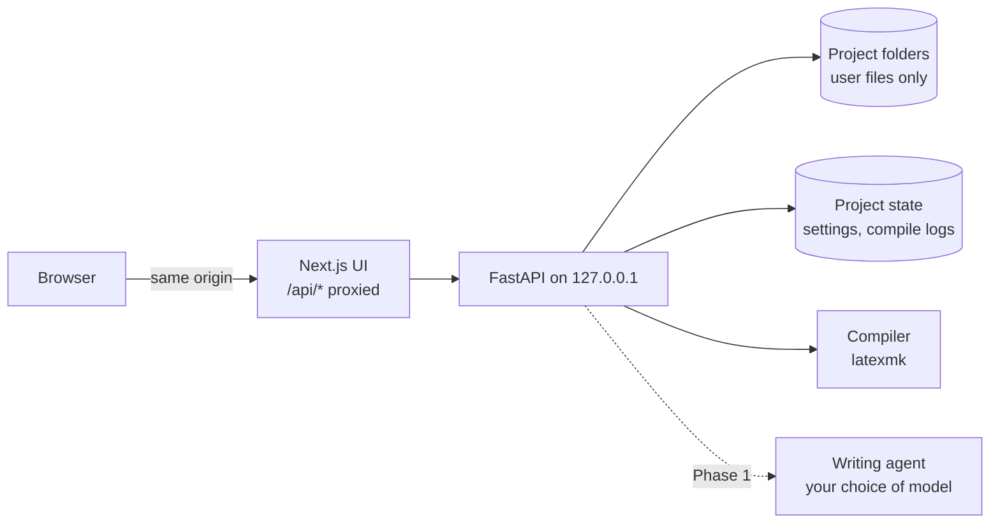

# PrismTeX

[](https://github.com/nvmaditya/OpenPrism/actions/workflows/ci.yml)
[](LICENSE)

A self-hosted LaTeX editor, being built around an AI agent that shows its work: every edit a reviewable diff that compiles, every citation checked, on the model you choose.

> **Status: pre-release.** Nothing has been released yet. The writing agent is being rebuilt and returns in v0.1.0; until then PrismTeX is a local LaTeX workspace without AI features.

## What works today

- **Projects.** Create a blank project, an example paper or an example résumé; import a ZIP (with limits on size, file count and compression ratio, and symlinks and paths outside the project rejected); rename and delete. An Overleaf download or an OpenAI Prism export imports directly: a shared top folder is stripped, the root file is detected, and a Prism export's `conversations/` folder is left out.
- **Files.** A file tree with upload into any folder, rename and delete. Saves carry the version the editor loaded, so a file changed on disk since you opened it is never silently overwritten.
- **Editor.** A plain text editor for now. CodeMirror arrives in Phase 2.
- **Outline.** The headings of every `.tex` file, each a link to its line.
- **Compile.** latexmk with pdflatex or xelatex, so bibliographies and cross-references resolve (lualatex is accepted as a project setting but disabled at compile time this release). Shell escape is off, a project cannot choose its own flags, and build output stays outside the project folder. Reading files during a compile is hardened but not fully sandboxed, so read [docs/compile.md](docs/compile.md) before compiling projects you do not trust.
- **Diagnostics.** Errors and warnings with file and line; clicking one opens the file at that line.
- **PDF preview.** The compiled PDF in the browser's own PDF viewer. A pdf.js viewer with SyncTeX arrives in Phase 2.
- **Project settings.** The root file and the TeX engine are set per project.

## Quickstart

You need:

- TeX Live or MiKTeX with `latexmk` (MiKTeX also needs Perl);
- Python 3.12 or newer;
- Node.js 22.

Create a virtual environment, install the backend into it, then start the API and the UI together:

```bash
git clone https://github.com/nvmaditya/OpenPrism.git
cd OpenPrism
python3 -m venv .venv
.venv/bin/python -m pip install -e 'backend[dev]'
./start.sh
```

The virtual environment is not optional on every system: on Ubuntu 24.04, Debian and Homebrew Python, a bare `pip install` into the system interpreter fails with `externally-managed-environment` (PEP 668). On Windows Git Bash the interpreter is `.venv/Scripts/python`. On Debian and Ubuntu, `python3 -m venv` may first need `sudo apt install python3-venv`.

Open <http://127.0.0.1:3000>. `start.sh` picks up `.venv` automatically, installs the UI's packages on first run, keeps data in `./data` and writes logs to `./logs`. Ctrl+C stops both servers. On Windows, run it from Git Bash.

To run the two servers yourself, in two terminals:

```bash
.venv/bin/python -m prismtex serve        # API on http://127.0.0.1:8000
```

```bash
cd frontend && npm install && npm run dev    # UI on http://127.0.0.1:3000
```

A Docker image arrives in Phase 4.

## Configuration

Settings come from `PRISMTEX_*` environment variables or a `.env` file in the directory the server starts from; copy `.env.example` to begin. [docs/configuration.md](docs/configuration.md) lists them all. The ones you are most likely to change:

| Variable | Default | Meaning |
|---|---|---|
| `PRISMTEX_DATA_DIR` | `data` | Where projects and their state live |
| `PRISMTEX_HOST`, `PRISMTEX_PORT` | `127.0.0.1`, `8000` | Where the API listens |
| `PRISMTEX_ACCESS_TOKEN` | unset | Required to bind beyond loopback; a LAN also needs the server's name or IP in `PRISMTEX_ALLOWED_HOSTS`, and in Phase 0 only API clients can send the token (see [SECURITY.md](SECURITY.md)) |
| `PRISMTEX_COMPILE_TIMEOUT_S` | `120` | Seconds before a compile is stopped |

The server binds 127.0.0.1 and refuses any other address unless an access token is set. Read [SECURITY.md](SECURITY.md) before exposing it to a network.

## Architecture



The backend is the `prismtex` Python package in `backend/src/prismtex`, and the UI is a Next.js app in `frontend/`. Project folders hold only your files: settings and compile logs live under `<data dir>/state/`, build output under `<data dir>/build/`, and History checkpoints under `<data dir>/history/`. The design documents in [docs/design](docs/design) and the decision records in [docs/adr](docs/adr) explain the rest.

## Roadmap

[ROADMAP.md](ROADMAP.md) has the phases and their exit criteria. In short: Phase 1 brings the new agent and v0.1.0, Phase 2 the real editor and PDF viewer, Phase 3 citation checks, and Phase 4 self-hosting with Docker.

## Contributing

Contributions are welcome. [CONTRIBUTING.md](CONTRIBUTING.md) covers setup, tests and commit style, and everyone taking part follows the [Code of Conduct](CODE_OF_CONDUCT.md). For questions, see [SUPPORT.md](SUPPORT.md).

## Security

Report vulnerabilities privately, as described in [SECURITY.md](SECURITY.md). Please do not open a public issue.

## License

[Apache License 2.0](LICENSE). See also [NOTICE](NOTICE).

PrismTeX is an independent project. It is not affiliated with or endorsed by OpenAI or Overleaf.
