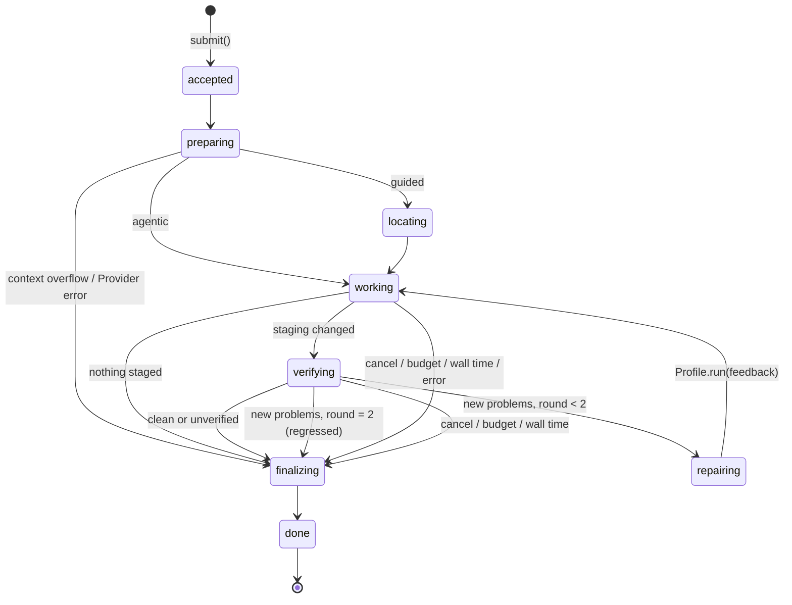

# PrismTeX agent: design

> Renamed to PrismTeX on 2026-11-25: read `openprism` as `prismtex` and `OPENPRISM_` as `PRISMTEX_`.

- **Date:** 2026-11-24
- **Status:** Proposed.
- **Audience:** maintainers and contributors, and anyone implementing Phase 1 of the revamp.
- **Companion to:** `docs/design/2026-11-24-revamp-design.md` (decisions D1 to D17 and D2b, data layout §6.3, security §6.6, configuration §6.7, quality §7). Terms follow `CONTEXT.md`, and ADRs 0001 to 0004 apply unchanged. A *content version* is the SHA-256 hex digest (64 digits) of a file's bytes on disk (its ETag); it is not a Checkpoint.
- **How it was made:** four candidate designs, each written under a different constraint, were compared for small-model reliability, architecture and delivery risk. This design keeps the engine and invariants of the minimal-interface candidate, takes its guided Profile from the candidate optimized for the qwen3 4B edit, and adopts specific parts of the other two.
- **Starting point (Phase 0):** the package `backend/src/prismtex`, with the composition root `create_app(settings)` in `prismtex.main`; `Settings` (pydantic-settings, `PRISMTEX_*` from the environment and `.env`); `DataLayout` and `ProjectStore(layout)`, whose `read(project_id, path)` returns `FileVersion(text, version, eol)` (LF text, a content version, `eol` `"lf"` or `"crlf"`) and whose `write(project_id, path, text, base_version)` raises `VersionConflict`; the data layout of revamp §6.3; `Compiler.compile(project_id, *, root_file, engine)` and `Compiler.compile_dir(...)` returning a `CompileResult` with structured `Diagnostic(file, line, severity, kind, message)`; one error envelope, `{"detail": {"code", "message", ...}}`; Host and Origin middleware; the old agent removed.

---

## 1. Summary

The agent is one deep module, `prismtex.agent`. The API layer and the eval harness reach it through three entry points:

```python
class Agent:
    async def submit(self, request: TurnRequest) -> TurnHandle: ...          # start a Turn; returns at once
    def attach(self, project_id: str, turn_id: str) -> TurnHandle: ...       # find a live or finished Turn
    async def resolve(self, request: ResolveRequest) -> ResolveResult: ...   # accept or reject Hunks

class TurnHandle:
    turn_id: str
    thread_id: str
    def events(self, after: int = 0) -> AsyncIterator[Envelope]: ...         # replay, then follow live
    async def cancel(self) -> bool: ...                                      # True if the Turn was running
    async def outcome(self) -> TurnOutcome: ...                              # resolves after finalization
```

Two shallow side doors complete the surface: `agent.reader` reads Project state for the GET routes, and `agent.threads` creates, renames and deletes Threads.

**The core invariant: a Turn never writes the Project folder.** Its edits land in a staging overlay and leave it only as a Proposal, which the user accepts through `resolve`; auto-accept (off by default) calls the same code. Whole defect classes from the audit disappear as consequences:

- there is nothing to roll back, so verification cannot veto legitimate work or overwrite the user's concurrent saves;
- a disconnect, a Stop or a crash cannot leave a half-edited file;
- the editor never reloads because of a running Turn, so an unsaved buffer is never overwritten;
- several edits to one file in one Step cannot lose each other;
- no tool has a path into Project state.

**Invariants callers may rely on:**

- **I1. No agent writes during a Turn.** Only `resolve` writes agent text into the Project folder, through `ProjectStore.write` with a base version, or `ProjectStore.write_new` for a file the Proposal creates.
- **I2. One `done`, last.** Every Turn that `submit` accepted emits exactly one `done` event, as its last event. `outcome()` resolves after finalization, on every exit path.
- **I3. One of each per Project.** At most one active Turn and at most one open Proposal exist per Project.
- **I4. Complete, ordered replay.** `events(after=n)` yields every event with `seq > n`, in order. Subscribing, abandoning a subscription or disconnecting never affects the Turn.
- **I5. `resolve` never writes over changed text.** A Hunk is applied only where its original lines are found exactly, and a file whose current version differs from a supplied base version is not written.
- **I6. Tools touch only Source files.** Tools read Source files, see Assets as metadata, write only Source files with an allowed extension, and cannot reach Project state.
- **I7. Truthful outcomes.** `done.status`, `outcome`, `verdict` and `summary` are computed from staged state, verification and errors, never from the model's text.
- **I8. Nothing is truncated by a server.** No request exceeds the context the Provider serves; the engine refuses before sending.

**What callers never need to know:** Provider and model resolution; Profile choice and intent routing; context budgets and Thread memory; the agentic tool loop or the guided Region rewrite; LaTeX plumbing; the JSON-escape guard; the Baseline, scratch compiles, host repairs and Repair rounds; Proposal computation, supersession and auto-accept; Usage and the cost guard; the per-Project lock, cancellation, finalization and crash recovery.

**The common case.** A user selects a paragraph and asks qwen3 4B (Ollama, 16,384-token context, 8 GB GPU) to make it more concise. `submit` returns in under 50 ms. The host takes the Region from the selection and emits `region`. The Baseline comes from the compile cache, or compiles while the model writes. One Step of 2 to 5 s streams the new text as `rewrite_delta` events. Host checks and plumbing run, a scratch compile takes 1 to 3 s, and `done` carries "Proposed 1 change in main.tex. Compiles with no new errors." The target is p50 ≤ 8 s and p90 ≤ 15 s, estimated from the timings of the 2026-11-24 runs; the eval harness measures it (task T26).

---

## 2. Module map

Records are frozen dataclasses, written here as `Name(field: type = default, ...)`. Protocols and classes with behaviour are written out.

### 2.1 Public surface: `prismtex.agent`

`prismtex/agent/__init__.py` re-exports exactly these names. The API layer and the eval harness import nothing else, except `prismtex.agent.testing` and `prismtex.agent.providers.fake`.

```python
ProfileName = Literal["agentic", "guided"]
Intent      = Literal["question", "edit", "unknown"]
TurnStatus  = Literal["completed", "cancelled", "failed", "budget_exhausted", "interrupted"]
Outcome     = Literal["answered", "proposed", "applied", "no_change", "clarify", "nothing"]
Verdict     = Literal["clean", "regressed", "unverified", "no_change"]

Selection(start_line: int, start_col: int, end_line: int, end_col: int)
    # 1-based lines and code-point columns in the LF text of the editor's base; end_col is exclusive,
    # and (n, 1) means "up to the start of line n"
EditorContext(path: str, version: str, cursor_line: int | None = None,
              selection: Selection | None = None, buffer: str | None = None)
    # version: the content version the buffer was loaded from or last saved as
    # buffer: the unsaved LF text, present if and only if the buffer is dirty (at most 2 MiB)
TurnRequest(project_id: str, message: str, thread_id: str | None = None,
            editor: EditorContext | None = None, model: str | None = None,
            profile: ProfileName | None = None)
    # message: 1 character to 64 KiB, newlines kept; thread_id None starts a new Thread
    # model: "preset:model"; None means the Project setting, then the default model (§11.6)
ResolveRequest(project_id: str, proposal_id: str,
               accept: Literal["all"] | frozenset[str] = frozenset(),
               reject: Literal["all"] | frozenset[str] = frozenset(),
               base_versions: Mapping[str, str] = {})          # optional If-Match per path
Usage(steps: int = 0, input_tokens: int = 0, output_tokens: int = 0, cache_read_tokens: int = 0,
      cache_write_tokens: int = 0, cost_usd: float = 0.0, estimated: bool = False)
    # input_tokens counts every prompt token, cached or not; cost_usd comes from integer micro-USD;
    # estimated: some Step was settled at its reservation
ErrorInfo(code: str, message: str, retryable: bool)            # codes in §9.3; no secrets, no paths
TurnOutcome(turn_id: str, thread_id: str, status: TurnStatus, outcome: Outcome, verdict: Verdict,
            summary: str, reply: str, proposal: Proposal | None, usage: Usage, error: ErrorInfo | None)
    # status: how the Turn ended; outcome: what it produced; verdict: "no_change" without a Proposal
    # summary: the host-written outcome line (D2b); reply: the model's prose, always shown as the model's
StaleHunk(hunk_id: str, path: str,
          reason: Literal["version_mismatch", "context_changed", "file_missing", "file_exists"])
FileState(path: str, version: str | None, text: str | None)   # None: deleted; text refreshes clean buffers
ResolveResult(proposal_id: str, applied: tuple[str, ...], rejected: tuple[str, ...],
              stale: tuple[StaleHunk, ...], undecided: tuple[str, ...], files: tuple[FileState, ...],
              checkpoint_id: str | None, closed: bool)
    # stale Hunks are not applied and stay undecided; closed: no undecided Hunks remain

class Agent:                     # an async context manager; FastAPI's lifespan enters it
    reader: AgentReader
    threads: ThreadAdmin
    async def submit(self, request: TurnRequest) -> TurnHandle: ...
    def attach(self, project_id: str, turn_id: str) -> TurnHandle: ...
    async def resolve(self, request: ResolveRequest) -> ResolveResult: ...
    async def __aenter__(self) -> "Agent": ...            # recovers interrupted Turns (§8.5)
    async def __aexit__(self, *exc: object) -> None: ...   # cancels active Turns, awaits finalization

def build_agent(config: AgentConfig, deps: AgentDeps) -> Agent: ...     # composition only

class AgentError(Exception):
    code: str
    message: str
    detail: dict[str, object]           # JSON-safe
class TurnRejected(AgentError): ...     # busy | project_not_found | thread_not_found | invalid_request
                                        # | editor_out_of_date | model_unavailable | budget_exhausted
class TurnNotFound(AgentError): ...
class ProposalNotFound(AgentError): ...
class ProposalClosed(AgentError): ...   # detail["open_proposal_id"]
class ProjectBusy(AgentError): ...      # detail["active_turn_id"]
```

**Ordering.** Handle methods may be called any number of times, in any order, from any task. `resolve` raises `ProjectBusy` while a Turn is active; the UI disables review actions during a Turn and offers Stop instead. A Turn starts from what the user sees: the Project, with a dirty editor buffer as the base of its file, plus the open Proposal's undecided Hunks (§6.2).

**Error modes.** Exceptions mean "can't start", "can't find" or "can't resolve". Everything that happens during a Turn is reported through events and `TurnOutcome`; `outcome()` never raises because a model, tool or compile failed. A static configuration problem, such as a missing API key, rejects at `submit` with `model_unavailable` and names the environment variable. A runtime Provider failure becomes an `error` event followed by `done(failed)`.

### 2.2 Modules behind the seam

All paths are under `backend/src/prismtex/agent/`. Data files live in `data/` (`commands.txt`, the known LaTeX commands; `packages.json`, macro or environment to package), and prompt text in `profiles/prompts/*.md`.

| Module | Interface | What the implementation hides |
|---|---|---|
| `engine.py` | `Agent`, `build_agent`, `TurnRegistry`, `ThreadAdmin` | The per-Project slot, background tasks, cancel tokens, recovery after a restart, graceful shutdown |
| `turn.py` | `TurnRunner.run() -> TurnOutcome` | The state machine, the Repair-round policy, the finalization order, the outcome line |
| `events.py` | `Envelope`, the event union, `to_json`, `event_schema()` | The schema version, encoding, the public and internal split |
| `trace.py` | `TraceWriter.emit`, `TraceReader.subscribe` | Sequence numbers, fan-out, replay from disk, internal events, the manifest |
| `steps.py` | `StepRunner.run(call, kind, sink)` | Fit, reserve, stream, settle, events and Trace records for one model call, shared by both Profiles |
| `context.py` | `ContextAssembler.system / pack / fit / plan_segment` | The stable prefix, the volatile block, token estimation and calibration, memory rendering, the never-truncate rule |
| `threads.py` | `ThreadStore` | Append-only JSONL, segments, Turn records, resolutions, verbatim provider messages |
| `staging.py` | `Staging` | The Turn's base, the overlay, the path policy, carry-forward of the open Proposal, the origin of host edits |
| `proposals.py` | `compute`, `rebase`, `ProposalDesk.publish / resolve` | Hunk computation and ids, line maps, change notes, rebase, Checkpoints, provenance trailers, auto-accept |
| `verify.py` | `Verifier.prime / check` | Baseline scheduling, scratch compiles, fingerprints, line mapping, verdicts, deterministic host repairs |
| `budget.py` | `BudgetGuard`, `Ledger` | Step, tool-call, wall-time, token and USD limits; worst-case reservation; settlement; the fsynced ledger |
| `text.py` | Pure text functions | Numbered views, the matching ladder, closest-match windows, escape-damage detection |
| `latex.py` | Pure LaTeX functions | Preamble detection, placement rules, BibTeX parsing, the macro-to-package table, fragment cleanup |
| `tools.py` | `ToolBox.run(call) -> ToolOutcome` | Tool specs, argument parsing and validation, the escape guard, read-only Turns, truncation, the repeat guard |
| `profiles/` | `Profile.run(scope, feedback)`, `choose_profile`, `classify_intent` | The agentic loop; the guided locate, rewrite and recipes; prompts |
| `providers/` | `ModelPort.stream / count_tokens`, `ModelResolver` | Anthropic, OpenAI-compatible and Ollama specifics; the fake, recording and replay adapters |
| `reader.py` | `AgentReader` | File locations and versioned JSON of Project state; deliberately shallow |
| `testing.py` | `make_deps`, `make_test_agent`, `seed`, `read_tree` | Temporary data roots, fixture Projects, fakes wired together |

**`engine.py`**

```python
AgentConfig(data_dir: Path, limits: Mapping[ProfileName, Limits] = DEFAULT_LIMITS,
            max_usd_per_turn: float = 1.00, ledger_path: Path | None = None,
            cost_stop_usd: float | None = None, strict_history: bool = False,
            trace_prompts: bool = False, turn_retention: int = 200, shutdown_grace_s: float = 15.0)
    # ledger_path: PRISMTEX_LEDGER_PATH, default <data_dir>/state/ledger.jsonl; one ledger for app and
    # eval use (§11.8); cost_stop_usd: cumulative stop (maintainer and eval runs: 9.50)
    # strict_history: Anthropic fails any history edit (evals, CI); AgentConfig.from_settings(settings)
AgentDeps(projects: ProjectStore, compiler: TreeCompiler, history: History, models: ModelResolver)

class TurnRegistry:                      # internal, one per process
    def acquire(self, project_id: str, turn_id: str, thread_id: str) -> Slot: ...  # raises Busy(active_turn_id)
    def active(self, project_id: str) -> LiveTurn | None: ...
    def live(self, turn_id: str) -> LiveTurn | None: ...
    def release(self, slot: Slot) -> None: ...

class ThreadAdmin:
    def create(self, project_id: str, title: str | None = None) -> ThreadInfo: ...
    def rename(self, project_id: str, thread_id: str, title: str) -> ThreadInfo: ...
    def delete(self, project_id: str, thread_id: str) -> None: ...     # ProjectBusy if its Turn is active
```

`submit` runs these steps in order; any failure after step 6 releases the slot. (1) Validate sizes: message 1 character to 64 KiB, buffer at most 2 MiB. (2) Check that the Project and, if given, the Thread exist. A Project with no Root file is not rejected: the Turn runs, nothing is compiled, and its verification is `unverified` with reason `no_root_file`. (3) Check the editor context: a clean editor (`buffer is None`) whose `version` differs from the file's current version is rejected with `editor_out_of_date`, so a selection never points at the wrong lines; any other problem (a path that is not a Source file, a selection out of range) drops the editor context with a `notice` and never rejects the Turn. (4) Resolve the model, choose the Profile (§4.1) and classify the intent. (5) Pre-check the cumulative cost stop for paid Providers. (6) Acquire the slot. (7) Capture the Turn's base (`TurnBase`): every Source file once, with the dirty buffer replacing its file. (8) Write the manifest and the `state/<project_id>/active_turn` marker, and emit `turn_started`. (9) Start `TurnRunner.run` as a tracked task and return the handle.

`attach` returns a live handle from the registry, or a replay handle over the Trace on disk, and raises `TurnNotFound`. `cancel()` on a finished Turn returns `False`. The registry is an in-memory dict under one `asyncio.Lock`; the server runs as a single process (decision 19).

**`turn.py`**

```python
class TurnRunner:
    def __init__(self, scope: TurnScope, profile: Profile, verifier: Verifier, desk: ProposalDesk,
                 threads: ThreadStore, trace: TraceWriter, policy: TurnPolicy) -> None: ...
    async def run(self) -> TurnOutcome: ...            # never raises; finalization always runs

TurnPolicy(max_repair_rounds: int = 2, auto_accept: bool = False, verify_after_failure_s: float = 60.0)
TurnScope(turn_id: str, request: TurnRequest, intent: Intent, spec: ModelSpec, steps: StepRunner,
          staging: Staging, outline: Callable[[], Outline], diagnostics: Sequence[DiagnosticView],
          context: ContextAssembler, memory: ThreadMemory, tools: ToolBox, emit: Callable[[Event], None],
          prime_baseline: Callable[[], None], cancel: CancelToken)
    # everything a Profile may touch, and nothing else; outline: the staged Outline, cached by digest;
    # diagnostics: the last known Baseline Diagnostics (may be empty); prime_baseline is idempotent
RepairFeedback(round: int, new: tuple[DiagnosticView, ...], host_fixes: tuple[str, ...])
ProfileResult(reply: str, stop: Literal["idle", "refused", "gave_up", "clarify"], edit_intent: bool)

def summarize(status: TurnStatus, outcome: Outcome, proposal: Proposal | None,
              verification: Verification, notes: Sequence[str]) -> str: ...
```

The Repair-round policy is shared by both Profiles and lives only here:

```python
async def _work(self) -> ProfileResult:
    mark = self.scope.staging.mark()
    result = await self.profile.run(self.scope, None)
    rounds = 0
    while self.scope.staging.changed_since(mark):          # nothing staged: no compile at all
        self.verification = await self.verifier.check(self.scope.staging, rounds)
        if self.verification.verdict != "regressed" or rounds == self.policy.max_repair_rounds:
            break
        rounds += 1
        mark = self.scope.staging.mark()
        result = await self.profile.run(self.scope, RepairFeedback(
            rounds, self.verification.new, self.verification.host_fixes))
    return result
```

`summarize` builds the outcome line from facts only: "Proposed 2 changes in main.tex. Compiles with no new errors."; "Proposed 3 changes in main.tex and refs.bib. 1 new error remains after 2 repair rounds: Undefined control sequence at main.tex:42."; "Proposed 1 change in sections/method.tex. Not compile-checked: TeX was not found."; "Proposed 1 change in notes.tex. Not compile-checked: the Project has no Root file."; "No change made. Stopped after repeated failed edits."; "Answered. Nothing was changed."; "Applied 2 changes (auto-accept: compiles with no new errors). Undo from History."; "Stopped. 2 unfinished changes were discarded." Change notes are appended in plain words ("Removes \input{sections/skills}.", "Adds a bibliography entry written by the model; check it.").

**`events.py`, `trace.py`**

```python
class TraceWriter:
    def emit(self, event: Event, *, internal: bool = False) -> Envelope: ...   # seq, append, flush, fan out
    def set_state(self, state: TurnState) -> None: ...                         # manifest, atomic replace
    def close(self, outcome: TurnOutcome) -> None: ...                         # after done; fsync
class TraceReader:
    def subscribe(self, after: int = 0) -> AsyncIterator[Envelope]: ...        # ends after done
    def manifest(self) -> Manifest: ...
    def envelopes(self, *, internal: bool = False) -> list[Envelope]: ...
def open_trace(data_dir: Path, project_id: str, turn_id: str) -> TraceReader: ...   # raises TurnNotFound
```

- **Files.** `state/<project_id>/turns/<turn_id>.jsonl` holds every envelope, public and internal; it is the Trace. `turns/<turn_id>.json` is the manifest.
- **Order.** `seq` starts at 1 and grows by one per event. `emit` appends one line and flushes before notifying subscribers; `done` is written exactly once, last, with fsync.
- **Subscribers** read an in-memory list while the Turn is live, so none can lag or be dropped. Ten minutes after `done` the list is released, and later readers replay from the file.
- **Internal events** are written but never streamed: `model_call` (estimated and reported prompt tokens, cache reads and writes, latency, stop reason, prompt version, context breakdown per part), `tool_io` (arguments and results, each cut at 4 KiB) and `decision` (Profile choice, intent, locate rule, trims, guard trips, host repairs, segment rollovers). The newest 200 Traces per Project are kept.

**`steps.py`**

```python
StepResult(message: Message, text: str, tool_calls: tuple[ToolCall, ...],
           stop: Literal["end", "tool_use", "max_tokens", "refusal"], usage: StepUsage,
           refusal_category: str | None)
class StepRunner:
    def __init__(self, model: ModelPort, context: ContextAssembler, budget: BudgetGuard,
                 trace: TraceWriter, cancel: CancelToken) -> None: ...
    async def run(self, call: ModelCall, *, kind: Literal["reply", "draft", "route"],
                  sink: Callable[[str], None] | None = None) -> StepResult: ...
```

One Step, in order: `budget.step()`; `context.fit(call)`; `budget.reserve(estimate, call.max_output_tokens)`, which may lower `max_output_tokens`; stream; settle; emit `usage`; record `model_call`. A `reply` Step streams text as `message_started`, `token` and `message_completed`; a `draft` Step hands text to `sink` (the guided parser); a `route` Step streams nothing. `ThinkingStarted` sets the status detail to "Thinking…". Token frames are coalesced to at most one per 30 ms. Text tool-call recovery runs here for models with that quirk (§4.6). It raises `ContextOverflow`, `BudgetExhausted`, `ProviderError` or `Cancelled`.

**`context.py`**

```python
TokenBudget(window: int, output: int, margin: int, cap: int | None)
    # .input = min(window - output - margin, cap); margin = max(512, 3% of window), at most 2,048
Part(key: str, text: str, required: bool, priority: int, shrink: tuple[Callable[[], str], ...] = ())
    # key: request, region, before, after, focus, excerpt, outline, editor, diagnostics, proposal,
    # since, memory, bib_keys, project; lower priority survives longer
class TokenEstimator:
    def __init__(self, chars_per_token: float) -> None: ...
    def estimate(self, text: str) -> int: ...                   # ceil(len / chars_per_token) + 4 per message
    def observe(self, chars: int, reported: int) -> None: ...   # only ever lowers chars_per_token
class ContextAssembler:
    def __init__(self, prompts: PromptSet, estimator: TokenEstimator) -> None: ...
    def system(self, profile: ProfileName, spec: ModelSpec) -> str: ...      # byte-stable; no Project data
    def pack(self, parts: Sequence[Part], budget: TokenBudget, *, fixed: int) -> Packed: ...
    def fit(self, call: ModelCall, spec: ModelSpec) -> ModelCall: ...
    def plan_segment(self, memory: ThreadMemory, block_tokens: int, spec: ModelSpec,
                     key: SegmentKey) -> Literal["continue", "new"]: ...
class ContextOverflow(Exception):
    needed: int
    limit: int
    breakdown: dict[str, int]
```

`pack` raises `ContextOverflow` when the required parts do not fit even after every `shrink` rendering. `fit` estimates the whole call before every Step and raises it before anything is sent (I8). §5 gives the rules and the numbers.

**`threads.py`**

```python
RegionRef(path: str, start_line: int, end_line: int)
TurnRecord(turn_id: str, at: str, status: TurnStatus, outcome: Outcome, model: str, profile: ProfileName,
           message: str, summary: str, proposal_id: str | None, targets: tuple[RegionRef, ...],
           added_text: str | None)
    # message: the first 500 characters; targets: where the Turn edited, in the proposed text;
    # added_text: up to 1,000 characters the Turn added, so "that sentence" can mean exactly it
Segment(segment_id: str, model: str, profile: ProfileName, prompt_version: str, effort: str | None,
        opened_by: Literal["new_thread", "model_switch", "prompt_version", "rollover"], summary: str | None)
Resolution(proposal_id: str, at: str, applied: tuple[str, ...], rejected: tuple[str, ...],
           stale: tuple[str, ...])
ThreadMemory(thread_id: str, records: tuple[TurnRecord, ...], segment: Segment | None,
             transcript: tuple[Message, ...], since_last_turn: tuple[Resolution, ...])
    # transcript: the current segment, exactly as sent and received (transcript memory only)

class ThreadStore:
    def create(self, project_id: str, title: str | None = None) -> ThreadInfo: ...
    def exists(self, project_id: str, thread_id: str) -> bool: ...
    def load(self, project_id: str, thread_id: str) -> ThreadMemory: ...
    def append_turn(self, project_id: str, thread_id: str, record: TurnRecord,
                    messages: Sequence[Message], segment: Segment | None) -> None: ...    # fsync
    def append_resolution(self, project_id: str, thread_id: str, resolution: Resolution) -> None: ...
    def rename(self, project_id: str, thread_id: str, title: str) -> ThreadInfo: ...
    def delete(self, project_id: str, thread_id: str) -> None: ...
    def list(self, project_id: str) -> list[ThreadInfo]: ...
    def view(self, project_id: str, thread_id: str) -> ThreadView: ...
```

A Thread is `state/<project_id>/threads/<thread_id>.jsonl`: typed records `thread`, `title`, `segment`, `turn`, `messages` and `resolution`, each with `"v": 1`. Renaming appends a `title` record; deleting removes the file. A Turn's records are appended before its slot is released, so the next Turn always sees them.

**`staging.py`**

```python
BaseFile(path: str, text: str, version: str, eol: Eol, source: Literal["disk", "buffer"])
    # eol: Phase 0's Eol, "lf" | "crlf"; version: the content version of the bytes (§6.2 step 1)
TurnBase(project_id: str, root_file: str | None, engine: Engine, files: Mapping[str, BaseFile],
         assets: tuple[str, ...])
    # captured once at submit; .tree() -> SourceTree is the Baseline tree; Asset bytes are never loaded;
    # root_file None: nothing is compiled and verification is unverified(no_root_file)
StagedText(path: str, text: str, view_id: str)        # view_id: 6 hex digits of sha256 over the staged text
StagedChange(path: str, op: Literal["modify", "create", "delete"], span: tuple[int, int] | None)

class Staging:
    @classmethod
    def open(cls, base: TurnBase, carry: Proposal | None) -> tuple["Staging", CarryReport]: ...
    def paths(self) -> list[str]: ...
    def read(self, path: str) -> StagedText: ...                                   # raises ToolError
    def write(self, path: str, text: str, *, by: Literal["model", "host"]) -> StagedChange: ...
    def create(self, path: str, text: str, *, by: Literal["model", "host"]) -> StagedChange: ...
    def delete(self, path: str, *, by: Literal["model", "host"]) -> StagedChange: ...
    def mark(self) -> int: ...
    def changed_since(self, mark: int) -> bool: ...
    def tree(self) -> SourceTree: ...                    # the Proposal tree
    def files(self) -> list[StagedFile]: ...             # base, start and staged text of each changed path
```

`ToolError` codes: `path_denied`, `write_denied`, `not_found`, `binary`, `exists`, `too_large` (over 1 MiB) and `control_char`. Writing text equal to a file's start text removes its overlay entry. Host writes record the lines they insert, so `compute` can mark the resulting Hunks `origin="host"`.

**`proposals.py`, `verify.py`, `budget.py`** (data shapes in §6.1, algorithms in §6.4, §7 and §11.8)

```python
def compute(files: Sequence[StagedFile], notes: Sequence[ChangeNote], verification: Verification,
            meta: ProposalMeta, carried: Proposal | None) -> Proposal | None: ...      # pure
def change_notes(before: Outline, after: Outline, files: Sequence[StagedFile]) -> tuple[ChangeNote, ...]: ...
def line_map(change: FileChange) -> LineMap: ...
def rebase(hunk: Hunk, current: Sequence[str]) -> Rebased: ...
class ProposalDesk:
    def open_proposal(self, project_id: str) -> Proposal | None: ...
    def get(self, project_id: str, proposal_id: str) -> Proposal: ...        # ProposalNotFound, ProposalClosed
    def publish(self, proposal: Proposal) -> None: ...                         # becomes the open Proposal
    async def resolve(self, request: ResolveRequest, *, by: Literal["user", "auto"]) -> ResolveResult: ...

DiagnosticView(file: str | None, line: int | None, severity: Literal["error", "warning", "info"],
               kind: str, message: str, excerpt: str | None)   # a Phase 0 Diagnostic plus its source line
Verification(verdict: Verdict,
             reason: Literal["cancelled", "tex_unavailable", "timeout", "masked", "no_root_file"] | None,
             rounds: int, baseline_errors: int, errors: int, new: tuple[DiagnosticView, ...],
             fixed: tuple[DiagnosticView, ...], new_warnings: int, host_fixes: tuple[str, ...], pdf: bool)
class Verifier:
    def __init__(self, compiler: TreeCompiler, base: TurnBase, trace: TraceWriter, cancel: CancelToken,
                 *, timeout_s: float = 120.0) -> None: ...
    def prime(self) -> None: ...                                   # start the Baseline compile; idempotent
    async def check(self, staging: Staging, round: int) -> Verification: ...
def diff_diagnostics(baseline: Sequence[DiagnosticView], proposal: Sequence[DiagnosticView],
                     maps: Mapping[str, LineMap]) -> DiagnosticDelta: ...   # pure
def fingerprint(d: DiagnosticView) -> str: ...

Limits(max_steps: int, max_wall_s: float, max_tokens: int, max_tool_calls: int)
Price(input: float, output: float, cache_write: float, cache_read: float)   # USD per MTok; 5-minute writes
class BudgetExhausted(Exception):
    kind: Literal["steps", "wall_time", "tokens", "tool_calls", "cost_turn", "cost_total"]
class BudgetGuard:
    def __init__(self, limits: Limits, spec: ModelSpec, ledger: Ledger | None, *,
                 max_usd_per_turn: float, cost_stop_usd: float | None) -> None: ...
    def step(self) -> None: ...
    def tool_call(self) -> None: ...
    async def reserve(self, est_input: int, max_output: int) -> Reservation: ...   # may lower max_output
    async def settle(self, r: Reservation, usage: StepUsage | None) -> int: ...    # micro-USD charged
    def usage(self) -> Usage: ...
    def remaining(self) -> Remaining: ...
class Ledger:
    def __init__(self, path: Path, *, exclusive: bool = False) -> None: ...   # exclusive: a lock file (evals)
    def committed_micro(self) -> int: ...          # settled rows plus open reservations
    def append(self, row: LedgerRow) -> None: ...  # one JSON line, then fsync
    def recover(self) -> int: ...                  # settles orphaned reservations at their full amount
```

**`text.py`, `latex.py`, `tools.py`** (rules in §4.4 to §4.6)

```python
View(path: str, start: int, end: int, total: int, view_id: str, body: str)
    # body: a header "path · lines a-b of n · view v1a2b3", then "  NN| text" lines
def render_view(path: str, text: str, start: int | None = None, end: int | None = None,
                *, max_lines: int = 250) -> View: ...
def str_replace(text: str, old: str, new: str) -> Applied | NotFound | Ambiguous: ...
def insert_after_line(text: str, line: int, new: str) -> Applied | OutOfRange: ...
def replace_lines(text: str, start: int, end: int, new: str) -> Applied: ...
def closest_match(text: str, needle: str) -> Closest: ...
def escape_damage(value: str, known: frozenset[str]) -> EscapeDamage | None: ...
def control_char(value: str) -> int | None: ...    # offset of a C0 character other than TAB and LF

Edit(path: str, after_line: int, lines: tuple[str, ...], note: str)    # insert after the line; 0 is the top
def ensure_package(root_text: str, name: str, options: str = "", *, root_file: str) -> Edit | None: ...
def insertion_point(outline: Outline, heading: Heading, *,
                    where: Literal["start", "end"] = "end") -> tuple[str, int]: ...
def insert_after_anchor(text: str, anchor: str) -> int | None: ...
def add_bib_entry(texts: Mapping[str, str], outline: Outline, entry: str) -> BibResult: ...
def wire_bibliography(root_text: str, outline: Outline, bib_path: str, *, root_file: str) -> tuple[Edit, ...]: ...
def strip_fragment_wrappers(fragment: str) -> tuple[str, tuple[str, ...]]: ...    # text, removed lines
def split_usepackages(fragment: str) -> tuple[str, tuple[tuple[str, str], ...]]: ...   # text, (name, options)
def packages_needed(text: str, loaded: frozenset[str]) -> tuple[str, ...]: ...
def environments_balanced(text: str) -> bool: ...
def bib_keys(bib_text: str) -> tuple[str, ...]: ...
def cite_keys(tex_text: str) -> tuple[str, ...]: ...

ToolSpec(name: str, description: str, input_schema: Mapping[str, Any], read_only: bool,
         latex_fields: frozenset[str] = frozenset())
    # input_schema: additionalProperties false, every field required, optional ones nullable
AGENTIC_TOOLS: tuple[ToolSpec, ...]      # 11 tools sorted by name (§4.2); part of the prompt version
READ_ONLY_TOOLS: tuple[ToolSpec, ...]    # outline, search, view
ToolOutcome(ok: bool, for_model: str, for_user: str, error_code: str | None, changed: tuple[str, ...])
    # for_model: at most 4,000 tokens; for_user: one line for the tool card; changed: staged paths
class ToolBox:
    def __init__(self, staging: Staging, outline: Callable[[], Outline],
                 check: Callable[[], Awaitable[Verification]], budget: BudgetGuard,
                 known_commands: frozenset[str], intent: Intent) -> None: ...
    def specs(self, memory: Literal["transcript", "records"]) -> tuple[ToolSpec, ...]: ...
    async def run(self, call: ToolCall) -> ToolOutcome: ...      # never raises on model mistakes
    @property
    def gave_up(self) -> bool: ...                               # the repeat guard tripped
```

**`profiles/`** (`__init__.py`, `agentic.py`, `guided.py`, `locate.py`, `protocol.py`, `recipes.py`; behaviour in §4)

```python
class Profile(Protocol):
    name: ClassVar[ProfileName]
    async def run(self, scope: TurnScope, feedback: RepairFeedback | None) -> ProfileResult: ...
def choose_profile(spec: ModelSpec, request: ProfileName | None, project: ProfileName | None) -> ProfileName: ...
def classify_intent(message: str, editor: EditorContext | None) -> Intent: ...
def make_profile(name: ProfileName) -> Profile: ...    # a new AgenticProfile or GuidedProfile per Turn

Region(path: str, start_line: int, end_line: int,
       kind: Literal["selection", "previous", "paragraph", "environment", "section", "diagnostic",
                     "insertion", "file"], label: str, focus: str | None = None)
    # 1-based inclusive lines; start_line == end_line + 1 marks an insertion point;
    # label: "Introduction, paragraph 2"; focus: the exact text to change inside the Region
Plan(action: Literal["rewrite", "insert", "answer", "remove", "rename", "cite", "clarify"],
     targets: tuple[Region, ...], rule: str, question: str | None = None, new_title: str | None = None)
    # at most 4 targets; rule: the locate rule that fired, for the Trace
def locate(view: Staging, outline: Outline, request: TurnRequest, memory: ThreadMemory,
           diagnostics: Sequence[DiagnosticView]) -> Plan | NeedsRouter: ...
def router_call(candidates: Sequence[Candidate], request: str, system: str) -> ModelCall: ...
def parse_route(reply: str, candidates: Sequence[Candidate]) -> Plan: ...
def render_rewrite(region: Region, parts: Sequence[Part], frame: Frame, system: str) -> ModelCall: ...
class RewriteParser:                     # incremental
    def __init__(self, frame: Frame) -> None: ...
    def feed(self, delta: str) -> list[Prose | BlockText]: ...
    def finish(self, stop: str) -> Rewrite | Answer | Malformed | Truncated: ...
def check_rewrite(region_text: str, new_text: str, *, in_preamble: bool, known_keys: frozenset[str],
                  loaded: frozenset[str]) -> RewriteCheck: ...
async def run_recipe(plan: Plan, scope: TurnScope) -> ProfileResult | None: ...   # None: not a recipe
```

**`providers/`** (`__init__.py`, `catalog.py`, `toolcalls.py`, `anthropic.py`, `openai_compat.py`, `ollama.py`, `fake.py`; adapters in §11)

```python
class ModelPort(Protocol):
    spec: ModelSpec
    def stream(self, call: ModelCall) -> AsyncIterator[ModelEvent]: ...   # cancel: close the iterator
    async def count_tokens(self, call: ModelCall) -> int | None: ...      # None: use the estimator
class ModelResolver(Protocol):
    def resolve(self, ref: str | None, project_default: str | None) -> ModelPort: ...  # raises ModelUnavailable
    def catalog(self) -> Sequence[ModelInfo]: ...
    async def health(self, *, probe: bool = False) -> HealthReport: ...               # never a paid call

ModelSpec(ref: str, provider: Literal["anthropic", "openai_compatible", "ollama", "fake"], model: str,
          context_window: int, input_cap: int | None, max_output: int, native_tools: bool,
          memory: Literal["transcript", "records"], prompt_caching: bool, default_profile: ProfileName,
          sampling: Mapping[str, float], effort: str | None, num_ctx: int | None,
          chars_per_token: float, price: Price | None, paid: bool, quirks: frozenset[str])
ModelCall(system: str, messages: tuple[Message, ...], tools: tuple[ToolSpec, ...] = (),
          max_output_tokens: int = 1024, response_schema: Mapping[str, Any] | None = None,
          seed: int | None = None)
    # max_output_tokens is always sent; response_schema is for router Steps only and never carries LaTeX
Message(role: Literal["user", "assistant"], blocks: tuple[TextBlock | ToolUseBlock | ToolResultBlock, ...],
        native: Mapping[str, Any] | None = None)
    # blocks: the neutral view; native: the exact provider payload, replayed verbatim by the same adapter
ModelEvent = TextDelta | ThinkingStarted | ToolCallCompleted | UsageReport | Stopped
ToolCallCompleted(id: str, name: str, raw_args: str, args: Mapping[str, Any] | None,
                  parse_error: str | None, recovered: bool)
Stopped(reason: Literal["end", "tool_use", "max_tokens", "refusal"], message: Message,
        refusal_category: str | None)
class ProviderError(Exception):
    code: Literal["auth", "not_found", "rate_limited", "overloaded", "unreachable", "timeout",
                  "bad_request", "context_overflow", "history_rejected"]
    retryable: bool
    retry_after_s: float | None
    message: str                          # plain language; no secrets, no host paths
```

**`reader.py`**

```python
class AgentReader:                        # no behaviour: it deserializes the versioned JSON the engine writes
    def state(self, project_id: str) -> AgentState: ...     # active Turn, open Proposal view, agent settings
    def proposal(self, project_id: str, proposal_id: str) -> Proposal: ...
    def threads(self, project_id: str) -> list[ThreadInfo]: ...
    def thread(self, project_id: str, thread_id: str) -> ThreadView: ...
    def turn(self, project_id: str, turn_id: str, *, trace: bool = False) -> TurnView: ...
    def models(self) -> list[ModelInfo]: ...
```

The read models `AgentState`, `ThreadInfo`, `ThreadView`, `TurnView`, `ModelInfo`, `HealthReport` and `AgentSettings` are records with the fields of their JSON shapes in §10.3.

**Helper records** referenced above:

```python
Slot(project_id: str, turn_id: str, thread_id: str)
LiveTurn(slot: Slot, task: asyncio.Task, cancel: CancelToken, trace: TraceWriter,
         outcome: asyncio.Future[TurnOutcome])
TurnState = Literal["accepted", "preparing", "locating", "working", "verifying", "repairing",
                    "finalizing", "done"]
Manifest(turn_id: str, thread_id: str, project_id: str, state: TurnState, model: str, profile: ProfileName,
         prompt_version: str, started_at: str, finished_at: str | None, status: TurnStatus | None,
         outcome: Outcome | None, verdict: Verdict | None, summary: str | None, proposal_id: str | None,
         usage: Usage, error: ErrorInfo | None)
StepUsage(input_tokens: int, output_tokens: int, cache_read_tokens: int, cache_write_tokens: int,
          served_model: str)
Packed(text: str, tokens: int, kept: tuple[str, ...], shrunk: tuple[str, ...], dropped: tuple[str, ...])
SegmentKey(model: str, profile: ProfileName, prompt_version: str, effort: str | None)
PromptSet(version: str, files: Mapping[str, str])  # version: 12 hex of sha256 over prompt files and tool specs
StagedFile(path: str, base: BaseFile | None, start: str | None, text: str | None,
           host_lines: tuple[tuple[int, int], ...])   # None text: deleted; host_lines: spans the host inserted
CarryReport(carried: tuple[str, ...], dropped: tuple[str, ...])          # Hunk ids of the open Proposal
ProposalMeta(turn_id: str, project_id: str, thread_id: str, model: str, profile: ProfileName,
             created_at: str, turn_ids: tuple[str, ...])
Rebased = Exact(at: int) | Shifted(at: int) | AlreadyApplied(at: int) | Stale(reason: str)
DiagnosticDelta(new: tuple[DiagnosticView, ...], fixed: tuple[DiagnosticView, ...],
                persisting: tuple[DiagnosticView, ...])
Reservation(id: str, micro_usd: int, est_input: int, max_output: int)
Remaining(steps: int, tokens: int, cost_usd: float | None, wall_s: float)
LedgerRow(kind: Literal["reserve", "settle"], id: str, micro_usd: int, project_id: str, turn_id: str,
          step: int, model: str, usage: StepUsage | None, estimated: bool)
Applied(text: str, span: tuple[int, int], rung: Literal["exact", "trailing_ws", "whitespace"])
NotFound(closest: Closest)                Ambiguous(lines: tuple[int, ...])         OutOfRange(total: int)
Closest(start: int, end: int, similarity: float, numbered: str)
EscapeDamage(line: int, col: int, kind: Literal["control", "tab_command", "newline_command",
             "literal_newline"], command: str | None, message: str)
BibResult(key: str, path: str, edits: tuple[Edit, ...], created: bool)
ToolCall(id: str, name: str, raw_args: str, args: Mapping[str, Any] | None, recovered: bool)
Candidate(index: int, path: str, start_line: int, end_line: int, label: str)
Frame(open: str, close: str)              # "<<<REPLACEMENT" and "REPLACEMENT>>>", plus a nonce on collision
NeedsRouter(candidates: tuple[Candidate, ...])
Prose(text: str)        BlockText(text: str)
Rewrite(text: str, prose: str)        Answer(prose: str)        Malformed(reason: str)        Truncated()
RewriteCheck(text: str, packages: tuple[tuple[str, str], ...], notes: tuple[ChangeNote, ...],
             reask: str | None)           # reask: the message for one re-ask, if a check failed
TextDelta(text: str)        ThinkingStarted()        UsageReport(usage: StepUsage)
TextBlock(text: str)        ToolUseBlock(id: str, name: str, input: Mapping[str, Any])
ToolResultBlock(tool_use_id: str, content: str, is_error: bool = False)
```

### 2.3 Platform interfaces the agent consumes

These belong to other modules (revamp §6.2). Phase 0 provides `ProjectStore` (`read`, `write`, `update`, `import_zip`), `content_version`, `encode_text`, `VersionConflict`, the path policy and the `Compiler`; Task T1 adds the workspace pieces below that Phase 0 does not provide; T3, T11 and T12 build the rest.

```python
class ProjectStore:                      # prismtex.workspace.store; ProjectStore(layout: DataLayout)
    def get(self, project_id: str) -> ProjectInfo: ...
    def list_files(self, project_id: str) -> list[FileEntry]: ...     # FileEntry(path, size, kind: "source" | "asset")
    def read(self, project_id: str, path: str) -> FileVersion: ...    # FileVersion(text: LF, version, eol: Eol)
    def write(self, project_id: str, path: str, text: str, base_version: str | None) -> FileVersion: ...
        # Phase 0: base_version None is unconditional (a PUT without If-Match); a stale one raises VersionConflict
    def write_new(self, project_id: str, path: str, text: str) -> FileVersion: ...
        # T1: creates an LF file; raises VersionConflict(current) when the path exists; used for creates
    def delete(self, project_id: str, path: str, *, base_version: str) -> None: ...   # raises VersionConflict
    def settings(self, project_id: str) -> ProjectSettings: ...       # root_file (None if unset), engine, agent
    def update_settings(self, project_id: str, **changes: object) -> ProjectSettings: ...
        # one read-modify-write of project.json, under the same lock as Phase 0's update()
    def project_dir(self, project_id: str) -> Path: ...               # compile materialization and History only
def content_version(data: bytes) -> str: ...    # Phase 0: SHA-256 hex (64 digits) of the bytes on disk
def check_source_path(path: str, *, for_write: bool) -> str: ...
    # T1, built on Phase 0's check_relative_path: normalized path, or raises PathDenied (§12),
    # a subclass of Phase 0's PathPolicyError

SourceTree(project_id: str, root_file: str, engine: Engine, overlay: Mapping[str, str | None],
           eols: Mapping[str, Eol], inputs: Mapping[str, str], digest: str,
           assets: Mapping[str, tuple[int, int]])
    # prismtex.compile.tree; overlay: path -> LF text (None: deleted) over the Project folder;
    # inputs: each Source path's content version (of its effective bytes) at capture;
    # assets: each Asset's (size, mtime_ns), so a scratch compile knows what to link;
    # digest: sha256 over the Root file, the engine, the inputs and each Asset's size and mtime;
    # the compile cache key is sha256(toolchain, digest)
class TreeCompiler(Protocol):            # ScratchTreeCompiler (TeX) and FakeTreeCompiler
    async def compile(self, tree: SourceTree, *, purpose: Literal["user", "baseline", "proposal"],
                      cancel: CancelToken, timeout_s: float = 120.0,
                      turn_id: str | None = None) -> CompileResult: ...   # turn_id names the scratch dir
    def peek(self, digest: str) -> CompileResult | None: ...             # a cache hit, without compiling

class History(Protocol):                 # prismtex.history: GitShadowHistory and NullHistory
    async def checkpoint(self, project_id: str, *,
                         reason: Literal["save", "accept", "auto_accept", "restore", "import"],
                         message: str, trailers: Mapping[str, str] | None = None) -> Checkpoint | None: ...
    async def list(self, project_id: str, *, limit: int = 50, before: str | None = None) -> list[Checkpoint]: ...
    async def diff(self, project_id: str, checkpoint_id: str, *, against: str | None = None,
                   path: str | None = None) -> str: ...                # unified diff
    async def restore(self, project_id: str, checkpoint_id: str, *,
                      paths: Sequence[str] | None = None) -> RestoreResult: ...

def build_outline(read: Callable[[str], str], paths: Iterable[str], root_file: str) -> Outline: ...
```

- **Compile results.** Scratch trees compile through Phase 0's `Compiler.compile_dir(src_dir, *, project_id, root_file, engine, out_dir, log_path)`, which takes no per-Project lock; `Compiler.compile` calls it under that lock for the user's own compiles. The agent uses the `CompileResult.status` property (`ok`, `failed`, `timeout`, `unavailable`), `diagnostics`, `pdf_path` and `duration_ms`. T11 sets the final Diagnostic kind set of the log parser (§7.3); the verifier relies on `undefined_citation`, `undefined_reference` and `fatal` (emergency stop, fatal error, job aborted).
- **Cancellation.** `CancelToken` (`prismtex/cancel.py`, T1) wraps an `asyncio.Event` with `set()`, `is_set()` and `raise_if_set()`; compiles and Provider streams take it.
- **Outline** (`prismtex.outline`, T3) carries headings with `path`, `line`, `end_line`, `level`, `title` and `label`; the `\input` graph from the Root file; labels with their reference counts; environment spans; bibliography files and keys; cited keys; loaded packages; the document class; and the Source files the Root file never includes. Its methods `section_at(path, line)`, `paragraph_at(path, line)`, `find_heading(query)` and `order(path, line)` (position in document order) serve the locator, the context and the verifier.
- **History** runs `git --git-dir=<data_dir>/history/<project_id>.git` (`DataLayout.history_git(project_id)`) `--work-tree=<project folder>` with `GIT_CONFIG_NOSYSTEM=1`, an empty global configuration, `core.autocrlf=false`, a fixed author identity and no hooks; `checkpoint` stages with `git add -A` under an exclude file that keeps compile outputs and Assets over 20 MiB out. `RestoreResult(checkpoint_id: str, files: tuple[FileState, ...])`.

---

## 3. Usage

### 3.1 Composition root and routes

```python
# prismtex/main.py: Phase 0's create_app(settings), extended with keyword-only test seams
def create_app(settings: Settings | None = None, *, models: ModelResolver | None = None,
               compiler: TreeCompiler | None = None) -> FastAPI:
    settings = settings or Settings()
    layout = DataLayout(settings.data_dir)
    projects = ProjectStore(layout)
    deps = AgentDeps(
        projects=projects,
        compiler=compiler or ScratchTreeCompiler.from_settings(settings),
        history=GitShadowHistory.detect(layout.history, projects) or NullHistory(),
        models=models or ProviderRegistry.from_env(settings),
    )
    agent = build_agent(AgentConfig.from_settings(settings), deps)
    app = FastAPI(lifespan=lambda _app: agent)            # Agent is an async context manager
    app.state.agent = agent                               # Phase 0 middleware and routers stay as they are
    for router in (agent_router, threads_router, proposals_router, history_router):
        app.include_router(router)
    return app

# prismtex/api/agent.py
router = APIRouter(prefix="/api/projects/{project_id}", tags=["agent"])

@router.post("/turns", status_code=202)
async def start_turn(project_id: str, body: TurnBody, agent: Agent = Depends(get_agent)) -> TurnStarted:
    try:
        handle = await agent.submit(body.to_request(project_id))
    except TurnRejected as exc:
        raise api_error(exc)                              # status mapping in §10.1
    return TurnStarted(turn_id=handle.turn_id, thread_id=handle.thread_id,
                       events_url=f"/api/projects/{project_id}/turns/{handle.turn_id}/events")

@router.get("/turns/{turn_id}/events")
async def turn_events(project_id: str, turn_id: str, after: int = 0,
                      last_event_id: str | None = Header(default=None),
                      agent: Agent = Depends(get_agent)) -> StreamingResponse:
    try:
        handle = agent.attach(project_id, turn_id)
    except TurnNotFound as exc:
        raise api_error(exc)
    start = int(last_event_id) if last_event_id and last_event_id.isdigit() else after
    return sse(handle.events(after=start))    # ": keepalive" every 15 s; a disconnect ends only this generator

@router.post("/turns/{turn_id}/cancel", status_code=202)
async def cancel_turn(project_id: str, turn_id: str, agent: Agent = Depends(get_agent)) -> dict[str, bool]:
    try:
        return {"cancelled": await agent.attach(project_id, turn_id).cancel()}
    except TurnNotFound as exc:
        raise api_error(exc)

@router.post("/proposals/{proposal_id}/resolve")
async def resolve(project_id: str, proposal_id: str, body: ResolveBody,
                  agent: Agent = Depends(get_agent)) -> ResolveResultBody:
    try:
        return ResolveResultBody.of(await agent.resolve(body.to_request(project_id, proposal_id)))
    except AgentError as exc:
        raise api_error(exc)
```

The routes are async end to end, so no sync generator runs in a thread pool, and a browser disconnect cancels only the SSE generator, never the Turn. Starting and streaming are separate requests; no event is lost between them because `events(after=0)` replays from the first event.

### 3.2 Eval harness

```python
# backend/evals/run.py
async def run_trial(task: EvalTask, model_ref: str, tmp: Path, *, lane: Literal["replay", "ollama", "anthropic"],
                    ledger_path: Path | None, cost_stop_usd: float | None) -> TrialResult:
    models = (ReplayModels(task.cassette(model_ref)) if lane == "replay"
              else ProviderRegistry.from_env(ledger_path=ledger_path))
    deps = testing.make_deps(tmp, models=models, compiler="tex" if task.needs_tex else "fake")
    config = AgentConfig(data_dir=tmp, ledger_path=ledger_path, cost_stop_usd=cost_stop_usd,
                         strict_history=lane == "anthropic")
    async with build_agent(config, deps) as agent:
        pid = testing.seed(deps.projects, task.fixture)
        thread_id, outcomes, events = None, [], []
        for turn in task.turns:
            handle = await agent.submit(TurnRequest(pid, turn.message, thread_id=thread_id,
                                                    editor=turn.editor_for(deps.projects, pid),
                                                    model=model_ref, profile=task.profile))
            events += [e async for e in handle.events()]
            outcome = await handle.outcome()
            thread_id = outcome.thread_id
            if turn.accept and outcome.proposal:
                await agent.resolve(ResolveRequest(pid, outcome.proposal.id, accept="all"))
            outcomes.append(outcome)
        return grade(task, outcomes, events, testing.read_tree(deps.projects, pid))
```

A paid model runs only in the `anthropic` lane, and only when both `ledger_path` and `cost_stop_usd` are set; otherwise `run_trial` raises before any request (§11.8). Each Trial has its own temporary data directory, so the ledger path is always passed explicitly: it is the same persistent ledger the app uses.

Graders read outcomes, not internals: changed lines lie inside the allowed Regions (from `proposal.files[*].hunks`); required strings are present in `new_text` and forbidden ones absent; no control characters appear; the verdict is not `regressed`; question tasks end with `outcome == "answered"` and no Proposal; `usage` feeds the efficiency columns. Tests drive the same facade through `testing.make_test_agent(tmp_path, model=FakeModel([...]), fixture="blank_crlf")`, with AnyIO's pytest plugin (`@pytest.mark.anyio`, installed with Starlette) as the async runner.

---

## 4. Profiles

A Profile decides only how one run turns a request, plus optional Repair feedback, into staged changes and a reply. Everything else (staging, verification, the Repair-round policy, Proposals, budgets, events, finalization) is shared.

### 4.1 Choosing a Profile and routing intent

- **Profile choice** (`choose_profile`): the request override wins, then the Project setting `agent.profile`, then the catalog default for the model (§11.6). Forcing `agentic` on a model without native tool calling is `TurnRejected(invalid_request)` with detail `profile_unfit`. Guided needs only text completion, so it runs on any model.
- **Intent** (`classify_intent`), a cheap heuristic:
  - **question:** the message ends with `?` or starts with a question word (what, why, how, which, where, when, who, is, are, does, do, can, could, should, would, explain, summarize, describe, list), and contains none of the edit verbs (add, append, insert, remove, delete, drop, cut, rewrite, rephrase, reword, fix, correct, change, replace, rename, make, shorten, condense, tighten, expand, extend, proofread, polish, improve, simplify, translate, format, convert, move, merge, split, cite, update, write);
  - **edit:** an edit verb is present;
  - **unknown:** neither. A misclassification costs at most a follow-up Turn, and review-first makes an unwanted edit harmless.

| Intent | Agentic | Guided |
|---|---|---|
| question | Forced read, read-only tools | `answer` with the same forced read; no compile |
| edit | Full toolset | Locate, then rewrite, insert or a recipe |
| unknown | Full toolset | Locate; `rewrite` when a target is found, otherwise `clarify` |

- **Forced read.** Claude 5.5 rejects forced `tool_choice`, so the host does the read: the Turn's first user message carries an `<excerpt>` with the most relevant text, chosen in this order: the selection; the section at the cursor; a heading or `\label` named in the message; the active file; the Root file and its `\input` files in document order. It is capped at 9,000 tokens, with numbered lines for agentic and plain lines for guided.
- **Read-only Turns keep the tool array constant.** For transcript memory (Claude), the full toolset is always sent, because changing `tools` within a Thread invalidates preserved thinking and the prompt cache. The ToolBox refuses write tools on question Turns with `read_only_turn`, and the volatile block says "This is a question: answer it and change nothing." For records memory (Ollama and OpenAI-compatible models), question Turns are sent only `READ_ONLY_TOOLS`, which saves tokens and distraction for small models.

### 4.2 Agentic, step by step

1. **First message.** One user message with the volatile block (§5.1), the forced read for questions, the "since your last Turn" note and the request.
2. **Step.** `StepRunner.run(call, kind="reply")` streams prose as `token` events. The assistant message is appended to the Turn's transcript exactly as received.
3. **Refusal.** `stop == "refusal"` ends the run with `stop="refused"`; the Turn fails with `provider_refused` and the category in the detail.
4. **Tools.** Each tool call, native or recovered from text (§4.6), runs through `ToolBox.run`, sequentially and in call order, so two edits to one file both apply. All results of a Step go back in one user message, with the repeat guard's STOP hint as a text block after the results.
5. **Truncated call.** A `max_tokens` stop that leaves a tool call unfinished gets an error result for that call: "Your tool input was cut off at the output limit. Make a smaller edit." This keeps every `tool_use` answered.
6. **End.** A Step with no tool calls ends the run (`stop="idle"`); a tripped repeat guard ends it with `stop="gave_up"`.
7. **Repair round.** The engine calls `run(scope, feedback)`, which appends one user message to the same conversation and loops again with the same tools:

```text
Your changes introduced 1 new compile error (repair round 1 of 2):
main.tex:42: Undefined control sequence \textbff
   41| We use three remedies.
 > 42| The \textbff{key} idea is residual connections.
   43| \label{sec:remedies}
The host already added \usepackage{booktabs}. Fix the error with the edit tools and change nothing else.
```

**Tools** (sorted by name; `latex_fields` are `old_str`, `new_str`, `text` and `bibtex`):

| Tool | Arguments | Behaviour |
|---|---|---|
| `add_bib_entry` | `bibtex` | Host plumbing (§4.4): parse, reject a duplicate key with different fields, create `refs.bib` and wire it if needed; returns the key; note `bib_entry_added` |
| `check` | none | Differential compile of the staged state (§7); the first 3 new problems with ±3 numbered lines; at most 3 calls per Turn |
| `create` | `path`, `text` | New Source file only; fragment wrappers stripped from a `.tex` file without `\documentclass`; note `not_included` if the Root file never includes it |
| `delete_file` | `path` | Staged deletion; note `file_deleted` |
| `ensure_package` | `name`, `options` | Host plumbing; idempotent |
| `insert` | `path`, `after_line`, `text`, `view_id` | Insert after a line of the view with that id; `stale_view` if the file changed since that view |
| `insert_after_heading` | `heading`, `text`, `where` | `heading` is a title, an Outline index or a `\label` key; `where` is `start` or `end` (default) of the section body; never after `\bibliography` or `\end{document}` |
| `outline` | none | Outline of the staged text: headings with line spans and labels, the `\input` graph, bibliography files, files the Root file never includes |
| `search` | `query`, `path`, `regex` | `path:line: text`, at most 50 hits, `.bib` files included |
| `str_replace` | `path`, `old_str`, `new_str` | Tolerant unique match (§4.5) |
| `view` | `path`, `start_line`, `end_line` | Numbered lines, at most 250, under a header with `view_id` |

The system prompt (`profiles/prompts/agentic.md`) states the research-writing rules: minimal changes, the author's voice kept, never invent a citation, number or result, packages and bibliography only through the plumbing tools, changes are proposals the user reviews. It contains no example paths, because fictional paths were copied by models in the live runs.

### 4.3 Guided, step by step

1. **Locate where.** The first rule that matches with confidence wins:

| # | Trigger | Target | Waits for |
|---|---|---|---|
| 1 | A selection | The selected lines, widened to whole environments the selection cuts; split at blank lines into paragraph Regions if over the cap; `focus` is the selected text when the selection lies inside one line | nothing |
| 2 | An anaphor with no selection ("it", "that sentence", "again", "shorter") and an earlier Turn record with targets | The earlier targets, re-found in the current view by their `added_text`, or by their line span when the file is unchanged since that Turn | nothing |
| 3 | A deictic phrase plus the cursor ("this paragraph", "this equation", "this table", "this section", "here") | The paragraph, environment or section around the cursor | nothing |
| 4 | A compile-fix request ("fix the errors", "doesn't compile") | ±6 lines around each Baseline error, merged and widened to whole environments, at most 4 | the Baseline |
| 5 | A quoted phrase, or a run of 4 or more words from the message, found exactly once (active file first) | Its paragraph | nothing |
| 6 | A heading title, label or ordinal named in the message (active file first) | That section | nothing |
| 7 | A whole-file request on a file that fits ("proofread the document") | The file's paragraphs in order, within the Step budget, then `notice(continued_later)` | nothing |
| 8 | None of the above | A router Step (below) | 1 Step |

2. **Decide what.** The action comes from the message and is applied to the target:

| Message shape | Action | Model Steps |
|---|---|---|
| Default (make, rewrite, fix, shorten, proofread, translate...) | `rewrite` each target Region | 1 per Region |
| A question with no edit verb | `answer` with the forced read; no compile | 1, prose only |
| Add or insert a table, figure, equation or paragraph | `insert` at the end of the target section's body; the model writes only the new text | 1 |
| Add a sentence | `rewrite` the target's last paragraph with the sentence appended | 1 |
| Remove, rename, cite | Recipes (below) | 0 to 2 |
| No target found for an edit | `clarify`: "Which part should I change? Select it or name the section." | 0 |

3. **Recipes** handle structural requests, where the 4B model failed in the live runs, as small deterministic host plans:

| Request shape | Model Steps | Host operations |
|---|---|---|
| Remove section X | 0 | If the section is only an `\input` or `\include` line, delete that line; the file stays, and deleting it is a separate change the user may accept. Otherwise delete from the heading line to the line before the next heading of the same or a higher level. Notes `heading_removed` or `input_removed`, with dangling references counted. |
| Rename section X to Y | 0 (1 if Y cannot be parsed from the message) | Rewrite only the heading line; keep its `\label` and optional short title |
| Add a table, figure, equation or paragraph to X | 1 | `insertion_point(X, "end")`; `ensure_package` for what the new text uses |
| Cite work W, or add a reference | 1 or 2 | A BibTeX entry pasted in the message is used as given. Otherwise one Step writes an entry between `<<<BIBTEX` and `BIBTEX>>>`, flagged `bib_entry_added` (unverified). Then `add_bib_entry`, `wire_bibliography`, and a rewrite of the target sentence with the key given. |

Section names are matched against Outline titles with a similarity of at least 0.8; more than one match gives `clarify` with the candidates. A wrong recipe match costs a rejected Proposal, not a damaged Project.

4. **Router Step**, only when rule 8 fires: the model sees numbered candidates (the sections and paragraph openings of the active file, at most 40) and replies with JSON that `response_schema` constrains: `{"action": "rewrite" | "insert" | "answer" | "clarify", "targets": [<index>, ...], "question": <string or null>}`. The reply carries indexes, never LaTeX.

5. **Prompt.** The system string (`profiles/prompts/guided_rewrite.md`) is byte-stable and is the cacheable prefix. It says: write the complete new text of the REGION between a line `<<<REPLACEMENT` and a line `REPLACEMENT>>>`, then one sentence saying what changed; change only `<focus>` when it is given; keep everything else exactly; never add `\documentclass`, `\usepackage`, `\begin{document}` or `\end{document}`; cite only keys listed in `<bib_keys>`; never invent a citation, number or result; answer a question in prose with no block; if the change cannot be made inside the Region, say so in one sentence with no block. The user message for one Region:

```text
<outline file="main.tex">L7-L11 \section{Introduction}  <- region
L13-L14 \section{Conclusion}</outline>
<before lines="5-8">...</before>
<region file="main.tex" lines="9-9">It is worth noting that, in many cases and in a large number of ...</region>
<after lines="10-11">...</after>
<memory>T-1: "Add a sentence about over-smoothing." -> Proposed 1 change in main.tex L9-L10 (pending).</memory>
<request>Make this paragraph more concise.</request>
```

6. **Replacement block protocol.** The reply is plain text; LaTeX never passes through JSON:

```text
reply         = { prose_line } , [ block ] , { prose_line } ;
block         = open_line , { body_line } , close_line ;
open_line     = "<<<REPLACEMENT" , [ " " , nonce ] ;          (* alone on its line; surrounding spaces ignored *)
close_line    = "REPLACEMENT" , [ " " , nonce ] , ">>>" ;
bibtex_block  = "<<<BIBTEX" , NL , { line } , "BIBTEX>>>" ;   (* cite recipe only *)
nonce         = 4 * hex_digit ;            (* used only when the Region itself contains a sentinel line *)
body_line     = any line that is not a close_line ;           (* taken verbatim; nothing is unescaped *)
```

`RewriteParser` is incremental. Prose before and after the block streams as `token` events; block text streams as `rewrite_delta` events for the live preview; a partial sentinel line is held back until it is complete. It strips one code fence around the whole body and a uniform `NN| ` prefix on every line. On `finish`:

| Reply | Result | What the Profile does |
|---|---|---|
| One complete block | `Rewrite(text, prose)` | Checks, then stages |
| No block | `Answer(prose)` | Answer, or, for an edit request, no change for that target with the prose as the reply |
| Open block without a close, stop `max_tokens` | `Truncated` | Re-ask once with the output raised to the cap (4,096) if it was lower; otherwise split the Region; otherwise no change and `notice(malformed_reply)` |
| Open block without a close, or two or more blocks | `Malformed(reason)` | Re-ask once ("Write the complete new text between a line <<<REPLACEMENT and a line REPLACEMENT>>>."); then no change and `notice(malformed_reply)` |

A re-ask is a Step, not a Repair round.

7. **Checks before anything is staged** (`check_rewrite`), cheapest first:

| Check | On failure |
|---|---|
| A control character other than TAB and LF | Re-ask once |
| The new text adds `\documentclass`, `\begin{document}` or `\end{document}` that the Region lacked | Stripped; note `wrapper_stripped` |
| The new text adds `\usepackage` lines and the Region is not the preamble | Lines removed; `ensure_package(name, options)` in the Root file as a host Hunk; note `package_added` |
| A new `\cite` key not among the Project's bibliography keys or this Turn's new entries | Re-ask once, listing the known keys |
| `\begin` and `\end` balanced in the Region before, but not after | Re-ask once, naming the environment |
| The text is identical to the Region | No change for that target |
| Macros or environments whose package is not loaded (`packages_needed`) | `ensure_package` as a host Hunk; note `package_added` |
| A new display equation with no relation symbol (`=`, `<`, `>`, `\le`, `\ge`, `\approx`, `\sim`, `\propto`, `\equiv`) | Note `equation_no_relation`, shown in review; never blocks |

8. **Stage.** A rewrite calls `staging.write` with the Region's lines replaced (`replace_lines`); an insertion inserts at the insertion point. Nothing outside the Region can change, apart from host Hunks in the preamble and the bibliography. With several targets (at most 4), each is one Step; targets are rewritten in document order and staged bottom-up within a file, and each Region's span in the staged text is tracked for Repair rounds. One compile verifies them together.

9. **Repair round.** Each new problem is routed to the target that contains its line, or the nearest target before it. The Profile re-sends that target's prompt unchanged, with the previous reply and one short user message appended, so Ollama reuses the cached prefix:

```text
Your new text causes this compile error:
region line 2: Undefined control sequence \textbff
  > The \textbff{key} idea ...
Reply with the corrected complete region in the same <<<REPLACEMENT ... REPLACEMENT>>> form.
```

### 4.4 Host-side LaTeX operations (`latex.py`)

Every operation writes through Staging with `by="host"`, so its effect appears as a Hunk with `origin="host"` that the user can reject. Every operation is idempotent.

- **`ensure_package(name, options)`** returns `None` when `\usepackage` or `\RequirePackage` already loads the package, alone or in a list. Otherwise it inserts `\usepackage[options]{name}` after the last `\usepackage` line in the preamble, or after `\documentclass`. If the package is loaded with different options it changes nothing and adds a note.
- **`insertion_point(outline, heading, where)`** returns the file and line inside the section body: at the end, before the next heading of the same or a higher level; at the start, after the heading line and its `\label`. It follows `\input` files, and it never lands after `\bibliography`, `\printbibliography` or `\end{document}`.
- **`insert_after_anchor(text, anchor)`**: the anchor is a `\label` key or a unique line of text. It inserts after the environment that contains the label, or after the line.
- **`add_bib_entry(texts, outline, entry)`** parses one BibTeX entry (`@type{key,` with balanced braces), reuses an existing identical entry, rejects a key that exists with different fields, writes to the `.bib` file the Root file references, or creates `refs.bib`, and returns the key, the path and the edits.
- **`wire_bibliography(root_text, outline, bib_path)`** does nothing when `\bibliography` or `\printbibliography` exists. With `biblatex` loaded it adds `\addbibresource{refs.bib}` to the preamble and `\printbibliography` before `\end{document}`; otherwise `\bibliographystyle{plain}` and `\bibliography{refs}` before `\end{document}`.
- **`strip_fragment_wrappers(fragment)`** removes `\documentclass`, `\begin{document}` and `\end{document}` lines from text bound for an included file or a Region, and returns the removed lines for the note.
- **`split_usepackages(fragment)`** removes `\usepackage` lines and returns them as (name, options) pairs for `ensure_package`.
- **`packages_needed(text, loaded)`** maps macros and environments to packages from `data/packages.json` (for example `\toprule` and `\midrule` to booktabs, `\includegraphics` to graphicx, `\url` to url, `\href` to hyperref, `\mathbb` to amssymb, `align` to amsmath, `\SI` to siunitx, `\multirow` to multirow, `tabularx` to tabularx, `\textcolor` to xcolor, `tikzpicture` to tikz) and returns those not loaded.
- **`environments_balanced`**, **`bib_keys`** and **`cite_keys`** are comment-aware scanners used by the checks.

### 4.5 Tolerant matching and closest-match errors

`str_replace` works on LF text, tries each rung of a ladder, and requires exactly one match on the rung that succeeds:

1. exact;
2. trailing whitespace ignored on every line;
3. runs of spaces and tabs collapsed, leading indentation ignored.

A tolerant match is named in the result ("matched ignoring indentation at lines 41-43"), and the replacement keeps the file's own indentation of the first line. Backslashes are never normalized and payloads are never repaired; that kind of repair corrupts correct LaTeX elsewhere.

A miss returns the closest window from `difflib.SequenceMatcher`, quoted raw with line numbers, never as `repr()`:

```text
str_replace failed: old_str was not found in sections/method.tex (312 lines).
Closest match (similarity 0.82) at lines 41-43:
  41| We train the model for 10 epochs with a learning rate of
  42| $10^{-3}$ and a batch size of 64.
  43| \label{sec:training}
Copy old_str exactly from these lines, without the "NN| " prefixes. Nothing was changed.
```

An ambiguous match says: "old_str matches 3 places (lines 12, 40, 77). Include neighbouring lines to make it unique. Nothing was changed." A path that does not exist adds "Did you mean: main.tex, sections/intro.tex?" (`difflib.get_close_matches` over the staged paths).

### 4.6 Argument parsing, escape guard, repeat guard, text tool-call recovery

- **Argument parsing** (`providers/toolcalls.parse_tool_arguments`): strict JSON first. On failure, one lenient retry doubles every backslash that is not a valid JSON escape (`\s`, `\c`, `\e`, `\l`, `\p`, `\v`, or `\u` without four hex digits). This is lossless, because no valid JSON contains those sequences, and a single-escaped `\section` then arrives intact. The Trace records `lenient: true`. Still invalid gives `invalid_args` with the position. Arguments are then validated against the tool's schema.
- **Escape guard** (`text.escape_damage`) on every `latex_fields` argument. It rejects, and never repairs:
  - C0 control characters other than TAB and LF: backspace from `\b` (`\beta`, `\begin`), form feed from `\f` (`\frac`, `\footnote`), and a CR from `\r` (`\ref`, `\right`);
  - TAB or LF followed by a letter run W, when `\t`+W or `\n`+W is a known command and W is not an English word (`extbf`, `heta`, `imes`, `ewline`, `oindent`, `ewcommand`, `abla`);
  - a backslash followed by `n` and then a non-letter: `\n` is not a LaTeX command, so it is a JSON double-escape of a newline.
  
  The known commands are `data/commands.txt` plus every `\newcommand`, `\renewcommand`, `\def` and `\DeclareMathOperator` in the Project. The message names the damage and the fix: "new_str line 3 has TAB+'extbf': JSON turned \t of \textbf into a TAB. Escape every backslash as \\ (write \\textbf). Nothing was changed."
- **Repeat guard.** The key is (tool name, hash of the canonical arguments, error code). The second identical failing call gets "STOP: this exact call already failed. Change old_str, or tell the user what blocks you." appended. The third is refused with `repeated` and trips `gave_up`, which ends the run; the summary says "Stopped after repeated failed edits."
- **Text tool-call recovery**, for models whose catalog entry has the `recover_text_tool_calls` quirk (Ollama models, the LM Studio preset). When a Step ends with no native tool calls, its text is scanned for JSON objects, bare or in a fenced block, of the form `{"name": <known tool>, "arguments" | "parameters": {...}}`. Each one is parsed as above and becomes a tool call with `recovered: true` and an id `rec_<n>`, plus `notice(text_tool_call_recovered)`. Text that names a known tool but fails to parse gets one re-prompt per Turn: "Your tool call was written as text and could not be read: <reason>. Call the tool with the tool-calling format."

### 4.7 Caps

| Cap | Guided | Agentic |
|---|---|---|
| Steps per Turn (model calls, including router, re-asks and Repair rounds) | 8 | 24 |
| Tool calls per Turn | none (no tools) | 60 |
| Wall time per Turn (model, tools, compiles) | 180 s | 600 s |
| Tokens per Turn (input plus output) | 150,000 | 800,000 |
| USD per Turn (paid Providers) | not applicable | $1.00 (`PRISMTEX_MAX_USD_PER_TURN`) |
| Output per Step | rewrite: min(4,096, ceil(1.5 × Region) + 256); answer 1,024; router 256 | catalog `max_output` (Claude 16,000; Ollama 1,024; OpenAI-compatible 8,192) |
| HTTP per Step | connect 5 s; 120 s between chunks; 180 s per Step | connect 10 s; 120 s between events; 300 s per Step |
| Region | 2,500 estimated tokens or 120 lines; at most 4 Regions | not applicable |
| `view` | not applicable | 250 lines |
| `search` | not applicable | 50 hits |
| Tool result to the model | not applicable | 4,000 tokens, cut with a note |
| `check()` | not applicable | 3 per Turn |
| Repair rounds | 2 | 2 |
| Compile | 120 s each | 120 s each |

Limits are configuration (`AgentConfig.limits`), never per request.

---

## 5. Context assembly and token budgets

### 5.1 Rules

- **Budget.** Every call fits in `input = min(window - output - margin, cap)`. For Ollama, `window` is the pinned `num_ctx`, so the server never truncates the prompt and never shifts context during generation.
- **Estimation.** `ceil(chars / chars_per_token)` plus 4 per message, seeded conservatively (3.0 characters per token for LaTeX on qwen3 and Claude) and calibrated only downward from reported prompt sizes. When the estimate is within 20% of the limit and the Provider can count tokens (Anthropic's free count endpoint), the exact count decides.
- **Stable prefix.** The system string is byte-identical per (Profile, prompt version) and contains no Project data: no file list, date or buffer. The tool array is sorted by name and is part of the prompt version.
- **Volatile block.** It opens each Turn's first user message, never the system prompt. Parts, from most to least important (the least important are trimmed first; the request is never trimmed): request; selection or Region; editor context (active file, version, dirty flag, cursor, selection with numbered lines, ±20 lines for agentic); forced read; the Outline map (headings with `file:Lstart-Lend` and labels, the `\input` graph, bibliography files; it collapses to top-level sections, then to the active file); Baseline Diagnostics (the first error with ±3 lines, plus counts); the open Proposal's summary; the "since your last Turn" note (accepted, rejected and stale Hunks; files the user changed); memory.
- **Unchanged parts.** Under transcript memory, the Outline map and the Diagnostics are sent in full only when they changed since the previous Turn of the segment; otherwise one line says they are unchanged.
- **Refusal.** If the required parts do not fit after every shrink, the Turn ends with `error(context_overflow)` and a per-part breakdown before any call. A guided Region that is too large is split first.

### 5.2 qwen3:4b-instruct-2507 at `num_ctx` 16,384 (guided)

| Part | Typical tokens | Cap |
|---|---|---|
| System | ~330 | fixed |
| Request | 30 to 200 | 1,500 |
| Region | 150 to 1,000 | 2,500 (or 120 lines) |
| Before and after (12 and 8 lines) | 200 to 500 | 800 |
| Outline (active file, one line per other file) | 150 to 400 | 600 |
| Diagnostics (at most 3, in or near the Region) | 0 to 150 | 300 |
| Memory (last 3 Turn records) | 0 to 300 | 400 |
| Bibliography keys (citation requests, or Regions with `\cite`) | 0 to 300 | 600 |
| Reserved output: ceil(1.5 × Region) + 256 | 480 to 1,756 | 4,096 |
| Margin | 512 | 512 |
| **Total** | **about 2.5k to 6k of 16,384** | |

An `answer` Step reserves 1,024 output tokens and takes the forced read up to 9,000 tokens. A router Step reserves 256 and lists at most 40 candidates (about 1,500 tokens). With the agentic Profile on qwen3 4B (an eval comparison, not the default), each Step reserves 1,024 output tokens, the 11 tool schemas take about 1,000 tokens (`READ_ONLY_TOOLS` about 300), and the oldest tool results of the Turn are cut to one-line stubs when needed; records memory allows that. The 16k context costs 5.1 GB of VRAM for qwen3 4B, measured on an 8 GB GPU (RTX 4070 Laptop).

### 5.3 Claude Haiku, Sonnet and Opus 5.5 (agentic)

| Part | Typical tokens | Cap |
|---|---|---|
| System and tools (cached; fixed per segment) | ~3,500 | fixed |
| Earlier Turns of the segment (cached reads) | 0 to 70,000 | rollover above 70% of the input cap |
| Project line (Root file, engine, Source file list) | 100 to 500 | 1,000 |
| Outline map (one line when unchanged) | 300 to 2,000 | 2,500 |
| Editor context with ±20 numbered lines | 0 to 2,000 | 3,000 |
| Baseline Diagnostics | 0 to 300 | 600 |
| Open Proposal and "since your last Turn" | 0 to 300 | 500 |
| Forced read (questions) | 0 to 9,000 | 9,000 |
| Request | 10 to 2,000 | 16,000 (64 KiB) |
| This Turn's Steps (each tool result at most 4,000) | 0 to 25,000 | the input cap |
| Reserved output per Step | 16,000 | 16,000 |
| **Input cap** | | **100,000** |

The served window is 1,000,000 tokens; the 100,000 input cap bounds the cost per Step and keeps Haiku 5.5 inside its lower price tier, which applies up to 100K prompt tokens.

### 5.4 Thread memory

- **Records memory** (guided on every Provider; agentic on Ollama and OpenAI-compatible models): the last 3 (guided) or 6 (agentic) Turn records render as `<memory>`, together with the previous Turn's reply for agentic and the "since your last Turn" resolutions. Tool transcripts of earlier Turns are never resent.
- **Transcript memory** (Anthropic): the current segment's messages, replayed exactly as sent and received (`Message.native`), thinking blocks and signatures included. History is append-only: nothing earlier is edited, reordered or removed, and the system string and tool array never change inside a segment.
  - **A new segment** starts when the model, the Profile, the prompt version or the effort changes, or at a Turn boundary when the estimated segment transcript plus the new volatile block exceeds 70% of the input cap. Its first user message opens with `<earlier_turns>`, a deterministic summary of the last 12 Turn records (request, outcome, files, resolution), and replays nothing else. This is the summary-plus-new-turn compaction shape that Claude's preserved thinking accepts.
  - **Within a Turn** nothing is ever trimmed. If the next Step would exceed the cap, the Turn ends with `context_overflow`, its staged work is kept as a Proposal, and the next Turn starts a new segment.
  - **A cancelled or failed Turn's messages** are cut back to the last complete exchange (every tool call answered). An incomplete assistant message from an aborted stream is never stored. The next Turn's first message notes "Your previous turn was stopped before it finished."
  - **`strict_history`** (eval and CI runs) asks the API to fail any request whose history changed (§11.2), so a bug in this rule cannot pass silently.

### 5.5 What is cacheable

| Provider | Cached | How |
|---|---|---|
| Anthropic | Tools and system per segment; the growing conversation | An explicit `cache_control` breakpoint at the end of the system text (tools render before it) plus top-level automatic caching, which places a breakpoint on the last cacheable block. Prefixes are well above the 512-token minimum. Hits are read from `usage.cache_read_input_tokens` and recorded in `model_call`. |
| Ollama | The KV prefix of the loaded model | The byte-stable guided system string; Repair rounds and re-asks resend the same prefix with messages appended; `num_ctx` never varies (a change reloads the model); `keep_alive` is 30 minutes. |
| OpenAI-compatible | Provider-side prefix caching where offered | The stable system string and sorted tools; `prompt_tokens_details.cached_tokens` is recorded. |

The volatile block is never cached on its first Step; once sent, it becomes part of the append-only prefix for the rest of the Turn and, under transcript memory, for later Turns.

---

## 6. Proposals

### 6.1 Data shapes

```python
Hunk(id: str, path: str, old_start: int, old_lines: tuple[str, ...], new_lines: tuple[str, ...],
     before: tuple[str, ...], after: tuple[str, ...], origin: Literal["model", "host"])
    # id: "h" + 12 hex of sha256(path, before, old_lines, new_lines, after), stable while content and
    # context are ("-2", "-3" on a collision); old_start: 1-based first base line replaced, or for a pure
    # insertion the line it follows (0 = top); lines are LF without terminators; before and after hold up
    # to 3 base lines each, for rebase
FileChange(path: str, op: Literal["modify", "create", "delete"], base_version: str | None,
           base_source: Literal["disk", "buffer"], hunks: tuple[Hunk, ...], new_text: str | None,
           added: int, removed: int)
    # base_version: the content version every Hunk of the file is relative to (None for create);
    # hunks are ordered by old_start and never overlap; new_text: the full proposed LF text (None for delete)
LineMap(path: str, runs: tuple[tuple[int, int, int], ...])
    # (base_start, base_end, offset) per unchanged run; .to_new(base_line) and .to_base(new_line)
    # return int | None, where None means the line was replaced or removed
ChangeNote(kind: Literal["heading_removed", "heading_renamed", "heading_added", "input_removed",
                         "input_added", "label_removed", "package_added", "package_removed",
                         "documentclass_changed", "preamble_changed", "file_created", "file_deleted",
                         "not_included", "bib_entry_added", "wrapper_stripped", "equation_no_relation"],
           path: str, line: int | None, before: str | None, after: str | None,
           dangling_refs: int = 0, origin: Literal["model", "host"] = "model")
    # dangling_refs: for label_removed, the \ref and \eqref still pointing at the label
DESTRUCTIVE = frozenset({"heading_removed", "heading_renamed", "input_removed", "label_removed",
                         "package_removed", "documentclass_changed", "preamble_changed",
                         "file_deleted", "bib_entry_added"})
Proposal(id: str, project_id: str, thread_id: str, turn_ids: tuple[str, ...], supersedes: str | None,
         model: str, profile: ProfileName, created_at: str, files: tuple[FileChange, ...],
         notes: tuple[ChangeNote, ...], verification: Verification, undecided: frozenset[str],
         auto_accept_eligible: bool)
    # id: the producing turn_id; turn_ids: the Turns whose Hunks it carries (provenance);
    # undecided: the Hunk ids not yet accepted or rejected
```

**Storage.** The open Proposal is `state/<project_id>/proposals/<proposal_id>.json` (`"v": 1`), written atomically (temporary file, then `os.replace`, retried on a Windows sharing violation). It is deleted when it closes or is superseded; the record survives in the Trace and in the accept Checkpoint's trailers. The `proposal` event carries a view without `new_text`, capped at 256 KiB, with `truncated` set when cut; `GET .../proposals/{id}` returns it whole.

### 6.2 Staging overlay

1. **Base.** At `submit`, `TurnBase` captures every Source file once: text, content version, line ending, and whether the base is the disk file or the dirty buffer. A dirty buffer's version is `content_version(encode_text(buffer, eol))`, with the disk file's line ending, which is the version the file will have once the buffer is saved. User saves during the Turn do not change what the Turn sees; `resolve` reconciles them later.
2. **Start text.** `Staging.open` rebases each undecided Hunk of the open Proposal onto the base, with the same `rebase` that `resolve` uses. Applied Hunks form each file's start text, so a follow-up such as "make it shorter" works on the text the user is reviewing. A Hunk that no longer applies is left out of the carried view, with `notice(proposal_carried_partially)`.
3. **Reads.** Tools and the locator read the staged text if the Turn changed the file, and the start text otherwise. Assets are listed with their size and are never read.
4. **Writes.** Every write runs the path policy, the extension allowlist and the control-character check, then replaces the staged text. Nothing reaches the disk.
5. **Compiles.** The Baseline compiles `TurnBase.tree()`; Proposal compiles use `Staging.tree()`. Both are overlays over the Project folder, materialized in scratch directories (§7.2).
6. **Freezing.** `compute` diffs each file's base text against its staged text with `difflib.SequenceMatcher(autojunk=False)` over LF lines. It returns `None` when no staged file differs from its start text; the open Proposal then stays as it is.

### 6.3 Supersession by a follow-up Turn

- A Turn that changes anything publishes a new Proposal whose id is its `turn_id`. It contains the carried undecided Hunks it did not touch, with the same ids because Hunk ids are content hashes, plus its own Hunks. All are relative to the Project's current base, and the new Proposal supersedes the old one, which is deleted.
- A Turn that changes nothing leaves the open Proposal alone.
- `resolve` on a superseded id raises `ProposalClosed` with `open_proposal_id`.
- "Discard it and do X instead" is `resolve(reject="all")` followed by `submit`; it needs no other interface.
- The Baseline is the Project content, not the Project plus the open Proposal, so errors carried in from earlier Turns count as new and Repair rounds fix the agent's own mistakes.

### 6.4 Accept and reject

`ProposalDesk.resolve(request, by)`:

1. **Validate.** The Proposal exists and is open; no Turn is active unless `by == "auto"`, which runs inside that Turn's finalization. Hunk ids are known and the accept and reject sets are disjoint; otherwise `AgentError(invalid_request)`.
2. **Apply, per file with accepted Hunks:**
   1. Read the current file (`FileVersion`).
   2. If `base_versions[path]` is given and differs from the current version, mark that file's accepted Hunks stale (`version_mismatch`) and skip the file.
   3. If the current version equals `FileChange.base_version`, apply the accepted Hunks directly.
   4. Otherwise rebase each accepted Hunk onto the current lines, bottom-up, trying in order:
      - **exact:** the old lines sit at `old_start`, shifted by the Hunks already applied;
      - **shifted:** `before + old_lines + after` matches exactly once anywhere in the file;
      - **old lines alone:** at least 2 lines long and found exactly once;
      - **already applied:** `new_lines` already sit at the anchor, so nothing is written;
      - **stale** (`context_changed`): none of the above; not applied.

      A pure insertion anchors on `before + after` being adjacent and unique. Nothing fuzzier is ever applied (I5).
   5. Write through `ProjectStore.write(path, text, base_version=current)`. The store writes the file's recorded line ending; a mixed-ending file comes back with its dominant ending, and the pre-accept Checkpoint keeps the original bytes. A `VersionConflict`, meaning a save landed between read and write, marks that file's Hunks stale.
   6. A `create` is written with `ProjectStore.write_new`, which refuses a path that exists (`file_exists`), so a file the user created during review is never overwritten; a `delete` requires that the current text equals the base (otherwise `context_changed`).
3. **Checkpoints** (§6.5).
4. **Decisions.** Applied and rejected Hunks leave `undecided`; stale Hunks stay undecided, so the user can reject them or ask for a follow-up. With nothing undecided the Proposal closes and its file is deleted; otherwise the reduced Proposal is rewritten.
5. **Memory.** A `Resolution` is appended to the Proposal's Thread, so the next Turn knows what was accepted and rejected.
6. **Return** a `ResolveResult` with every written file's new version and LF text.

### 6.5 Checkpoint on accept

Before writing, `History.checkpoint(reason="save", message="Changes before accepting proposal t_...")` commits any user edits the History has not seen, so a restore can separate the user's text from the agent's. After writing, one Checkpoint for the whole call: reason `accept` (or `auto_accept`), message "Accept proposal t_...: 3 changes in main.tex", and trailers `Proposal:`, `Turns:`, `Model:`, `Profile:` and `Hunks:`. These trailers are the Provenance record; any queryable index built later (Phase 3) is derived from them and can be rebuilt from History. Without git (`NullHistory`), accept still works and `checkpoint_id` is `None`; `GET /api/agent/health` warns about it.

### 6.6 Auto-accept

- **Setting:** `agent.auto_accept` in `project.json`; off by default.
- **Eligible when all of these hold:** the Turn's status is `completed`; the verdict is `clean`; no note is in `DESTRUCTIVE` (so a model-written bibliography entry is never auto-accepted); every file's base is the disk, not a dirty buffer.
- **How:** finalization calls `ProposalDesk.resolve(accept="all", base_versions=<each FileChange.base_version>, by="auto")`. A file saved during the Turn goes stale and stays undecided rather than being forced.
- **What the UI sees:** a `resolved` event with `by: "auto"`, outcome `applied` (or `proposed` if some Hunks went stale), and a summary such as "Applied 2 changes (auto-accept: compiles with no new errors). Undo from History." An ineligible Proposal stays open with the reason in the summary: "Not auto-applied: removes a section; review it."

### 6.7 How the dirty editor buffer is protected

1. **No agent write during a Turn** (I1). The event stream has no `file_changed` event; `tool_result.changed` names staged paths only. Nothing makes the editor reload while a Turn runs.
2. **The dirty buffer is the base.** The UI sends `editor.buffer` when the buffer is dirty. The Turn edits exactly what the user sees, and its Hunks for that file are relative to the buffer's content version (`base_source="buffer"`). A clean editor with a stale version is rejected at `submit` (`editor_out_of_date`); the UI reloads the file and resends.
3. **Save, then resolve.** When the user accepts, the UI first saves any dirty buffer of an affected file through the normal save path with `If-Match` (a 409 opens the existing conflict bar), then calls `resolve` with `base_versions` set to the versions it now holds. The server rebases onto the saved text.
4. **Reload rules.** `ResolveResult.files` lists every written file with its new version and text. The UI replaces only non-dirty buffers, as one undoable step; a dirty buffer keeps the user's text and shows "Changed on disk: Keep mine, Take theirs, Compare".
5. **Writes happen only where a Hunk's original text is still present** (I5). The user's text is never overwritten by an agent change; at worst the agent's Hunk goes stale.

---

## 7. Verification

### 7.1 Baseline capture and caching

- **Baseline tree:** `TurnBase.tree()`, the Project with the dirty buffer overlaid. Its Diagnostics are the Baseline.
- **When it starts:** guided, right after locating, if the action edits; agentic, at the first staged write (`prime`). Question Turns never compile.
- **Cache:** `TreeCompiler` caches each `CompileResult` under sha256(toolchain, `SourceTree.digest`), where the digest covers the Root file, the engine and every input's content. The user's own Compile button goes through the same compiler with an empty overlay, so a Turn that starts after a compile of the same content gets its Baseline free. A Proposal tree that a model `check()` already compiled is not compiled again.
- **User compiles never reuse scratch output.** A `purpose="user"` compile reuses only results of earlier user compiles, whose PDF, SyncTeX file and log live in `build/<project_id>/out/`. On a hit from a Baseline or Proposal compile (for example right after the user accepts a Proposal whose tree was already compiled in scratch), it compiles again, because the scratch directory that held that PDF is deleted at finalization.
- **Cancellation:** an unfinished Baseline compile is cancelled at finalization; nothing runs after `done`.

### 7.2 Scratch compile

`ScratchTreeCompiler` materializes each tree in `build/<project_id>/scratch/<turn_id>/<digest>/`. Overlaid Source files are written with their own line ending; other Source files are copied; Assets are hard-linked from a per-Project asset cache, `build/<project_id>/assets/`, never from the Project folder, so a TeX `\openout` in the scratch directory cannot write through a link into a user's file. A cache entry whose size or modification time no longer matches its source is copied again. Phase 0's `Compiler.compile_dir` then runs with its hardened argv and `.fls` audit, the tree in `<digest>/src/` and the output in `<digest>/out/` (it refuses an output folder inside the source folder), and no per-Project lock, so a Baseline compile neither waits for nor blocks the user's own Compile. Paths in Diagnostics are mapped back to Project-relative paths. The Turn's scratch directory is deleted at finalization, retried on Windows, where TeX can hold file handles briefly; leftovers are removed at the next startup.

### 7.3 Diagnostic fingerprinting and matching

- **Diagnostic kinds.** The log parser emits these kinds: `tex_error`, `undefined_control_sequence` (message `Undefined control sequence \cmd`, the command at the end of TeX's top context line, which is the `l.N` line for an error in the source text), `undefined_environment` (`Environment X undefined`), `fatal` (emergency stop, fatal error, job aborted), `latex_warning`, `package_warning`, `undefined_reference`, `undefined_citation` and `overfull_box`, plus the finer kinds Phase 0 already emitted and `docs/compile.md` lists: `missing_file`, `latex_error` and `package_error` (errors that would otherwise be `tex_error`), `multiply_defined_label` and `font_warning` (warnings that would otherwise be `latex_warning`), and `underfull_box`. The BibTeX log adds `bibtex_error` and `bibtex_warning`, and the compiler `access_denied`, `compile_failed`, `timeout`, `tex_missing` and `engine_disabled`. The verifier adds `no_pdf`.
- **Problems** are error-severity Diagnostics, warnings of kind `undefined_citation` and `undefined_reference` (an invented `\cite` key must not pass), and "no PDF produced" (`no_pdf`) when the Baseline produced one. Other warnings are counted, never blocking.
- **Excerpt:** the verifier reads the source line a Diagnostic points at from the tree that was compiled, and collapses its whitespace.
- **Fingerprint:** sha256 over (`file`, `kind`, the message with digit runs masked as `#`, the normalized excerpt). It contains no line number, so an edit that moves a pre-existing error does not make it new.
- **Matching** (`diff_diagnostics`):
  1. Multiset match by fingerprint.
  2. For Proposal problems still unmatched: match an unmatched Baseline problem with the same `file`, `kind` and masked message whose line, mapped through `LineMap.to_new`, is within ±2 lines of the Proposal problem; or whose Baseline line lies inside a replaced Hunk while the Proposal line lies inside that Hunk's new lines.
  3. Unmatched Proposal problems are **new**; unmatched Baseline problems are **fixed**.

### 7.4 Verdicts

| Verdict | Meaning |
|---|---|
| `no_change` | Nothing was staged, or the Turn's changes were discarded; no compile ran |
| `clean` | The Proposal tree compiled and has no new problems |
| `regressed` | New problems remain after the Repair rounds; the Proposal is kept, flagged with its new Diagnostics, and never auto-accepted |
| `unverified` | The check did not happen or cannot be trusted. `reason`: `cancelled`; `tex_unavailable` (no TeX); `timeout`; `no_root_file` (the Project has no Root file, so nothing was compiled); or `masked`, meaning the Baseline stopped at a `fatal` Diagnostic located before the first changed line in document order, so the changed text was never compiled. Never shown as "compiles". |

### 7.5 Host repairs before model repairs

When a verification round finds new problems, deterministic host repairs run first, at most once per round, adding at most one compile to it:

- "Undefined control sequence" or "Environment X undefined" for a command or environment in `data/packages.json` gives `ensure_package` (`\toprule` gives booktabs);
- "\begin{document}" or "\end{document}" errors inside an included file: `strip_fragment_wrappers` on the Turn's Hunks in that file;
- an undefined citation whose key this Turn added to a `.bib` file that is not wired: `wire_bibliography`.

Each repair becomes a host Hunk listed in `Verification.host_fixes`. Only problems that remain go to a model Repair round (at most 2). A Turn therefore runs at most one Baseline compile and six verification compiles (three rounds, each with at most one host-repair recompile), plus up to three `check()` compiles in an agentic Turn, all of them served from the digest cache when the tree is unchanged. In the common case it runs one of each, or only the Proposal compile when the Baseline is a cache hit.

### 7.6 Structural changes

`change_notes` compares the Outline of the base with the Outline of the staged text, and adds notes from the host operations. The kinds are the `ChangeNote` kinds: headings removed, renamed (matched by an unchanged `\label`, otherwise by position plus title similarity) or added; `\input` changes; labels removed, with dangling references counted; packages added or removed; preamble and document-class changes; files created, deleted or never included; model-written bibliography entries; stripped wrappers; equations with no relation symbol. Notes never change the verdict and never reject anything. They appear in the Proposal, in the outcome line and in review, and destructive kinds block auto-accept.

---

## 8. Turn lifecycle

### 8.1 State machine



The state is written to the manifest on every transition and emitted as `status`.

### 8.2 Exits

| Exit | `status` | Verification at finalization | Staged changes |
|---|---|---|---|
| The Profile finished; verification done | `completed` | already done | A Proposal (`clean`, `regressed` or `unverified`) |
| The Profile finished; nothing staged | `completed` | none | None; an open Proposal is untouched |
| `cancel()` | `cancelled` | none | Discarded; an open Proposal is untouched |
| Step, tool-call, token or cost limit | `budget_exhausted` | if wall time remains, at most 60 s, no Repair round | A Proposal, verified if possible, otherwise `unverified` |
| Wall time | `budget_exhausted` | none | A Proposal, `unverified` (`timeout`) |
| Provider error, context overflow, internal error | `failed` | if wall time remains, at most 60 s, no Repair round | A Proposal, verified if possible |
| The process stopped | `interrupted` | none | Lost; the Project is untouched |

**Outcome**, decided in this order: `applied` if auto-accept applied every Hunk; `proposed` if a Proposal was published; `clarify` if the Profile asked which place was meant; `no_change` if the request asked for a change and nothing was staged; `answered` if the Turn produced prose; `nothing` otherwise (a Turn cancelled or failed before producing anything).

### 8.3 Lock, background task and cancel

- **One active Turn per Project.** `TurnRegistry.acquire` is non-blocking: a second `submit` gets `busy` with the active `turn_id`, and the UI attaches to that Turn instead of failing. Turns of different Projects run concurrently.
- **Background task.** The Turn runs in its own `asyncio` task held by the registry, so no HTTP request owns it. A browser that disconnects, or never subscribes, has no effect on it.
- **Cancel.** `cancel()` sets the Turn's `CancelToken`. The Turn checks it before every Step, tool call and compile; Provider streams close their HTTP response; compiles kill their process tree. If the Turn has not reached finalization within 2 s, the engine cancels the task, and the `CancelledError` lands in the runner's `finally`. `done(cancelled)` follows within about a second plus finalization.
- **Wall time** is an `asyncio.timeout` around working, verifying and repairing.

### 8.4 Finalization

Finalization runs in `finally`, as a task the registry tracks and that `asyncio.shield` protects, so a second cancellation cannot interrupt it. Each step is guarded on its own: a failing step emits `error(fatal=false, code="internal")`, is recorded in the Trace, and the remaining steps still run.

1. Stop work: close the Provider stream, cancel compiles, including an unfinished Baseline.
2. Verify, if the exit table calls for it.
3. `proposals.compute(...)`; if it returns a Proposal, `desk.publish` it and emit `proposal`.
4. Auto-accept if enabled and eligible; emit `resolved`.
5. `threads.append_turn(...)` with the Turn record and, under transcript memory, the messages cut back to the last complete exchange.
6. Settle open reservations, append the ledger rows, emit the final `usage`.
7. Write the manifest's summary fields and prune Traces beyond the retention.
8. Release the slot and remove the `active_turn` marker.
9. Emit `done`, close the Trace, delete the scratch directory.

The slot is released before `done`, so a client that reacts to `done` by sending its next message never gets `busy`.

### 8.5 Crash recovery and shutdown

- **Startup** (`Agent.__aenter__`): for each `state/<project_id>/active_turn` marker, the Turn is closed as `interrupted`. The engine appends `error(code="interrupted")` and `done(status="interrupted", outcome="nothing")` to the Trace, writes the manifest, appends a Turn record to the Thread, removes the scratch directory and the marker, and settles that Turn's orphaned ledger reservations at their full amount. The open Proposal, if any, is untouched, and the Project was never written.
- **Shutdown** (`Agent.__aexit__`): every active Turn is cancelled, and finalization is awaited for up to `shutdown_grace_s` (15 s).

---

## 9. Events

### 9.1 Envelope and wire format

Every event is one JSON object, `{"v": 1, "seq": n, "turn_id": "...", "at": "<RFC 3339 UTC>", "type": "...", ...fields}`, sent as SSE:

```text
id: 7
event: token
data: {"v":1,"seq":7,"turn_id":"t_20261124T231004_9f3a","at":"2026-11-24T23:10:04.120Z","type":"token","message_id":"m1","delta":"I propose "}
```

- `seq` starts at 1 and has no gaps within a Turn; it is the SSE `id`.
- A comment line (`: keepalive`) goes out every 15 s.
- **Versioning.** New event types and new optional fields keep `v` at 1; clients ignore unknown types and fields. Renaming or removing anything, or changing a meaning, bumps `v`, and the server keeps the previous encoder for one release. `events.py` exports a JSON Schema, from which the frontend generates its types; a snapshot test fails on any unreviewed change.

### 9.2 The event union (v1)

| `type` | Fields | When |
|---|---|---|
| `turn_started` | `thread_id`, `profile`, `model`, `intent`, `limits` (`max_steps`, `max_wall_s`, `max_cost_usd`) | Always `seq` 1 |
| `status` | `state` (`preparing`, `locating`, `working`, `verifying`, `repairing`, `finalizing`), `detail?` | Every state change; `detail` is "Thinking…", "Editing sections/method.tex L42-60", "Repair round 1 of 2" |
| `region` | `index`, `path`, `start_line`, `end_line`, `kind`, `label` | Guided, before that Region's Step |
| `message_started` | `message_id`, `step` | Before the first token of an assistant message |
| `token` | `message_id`, `delta` | Prose deltas, coalesced to at most one frame per 30 ms |
| `message_completed` | `message_id`, `text`, `stop` (`end`, `tool_use`, `max_tokens`, `refusal`) | Message boundary |
| `rewrite_delta` | `index`, `delta` | Guided replacement text as it is written; a preview, not a Proposal |
| `tool_call` | `call_id`, `message_id`, `name`, `args` (string values cut at 200 characters), `recovered` | Once the call's arguments are complete |
| `tool_result` | `call_id`, `ok`, `summary`, `error_code?`, `changed[]` (staged paths) | Exactly one per `tool_call` |
| `compile` | `stage` (`baseline`, `proposal`), `round`, `state` (`started`, `finished`, `cached`), `ok?`, `errors?`, `warnings?`, `duration_ms?` | Around each compile; a cache hit sends only `cached` |
| `diagnostics` | `round`, `new[]`, `fixed[]`, `persisting_errors`, `host_fixes[]`; each Diagnostic as `{file, line, severity, kind, message, excerpt}` | After each Proposal compile |
| `proposal` | `proposal` (the Proposal without `new_text`; `truncated` if cut at 256 KiB) | At most once, in finalization, after the final verification |
| `resolved` | `proposal_id`, `applied[]`, `stale[]`, `files[]` (`path`, `version`), `checkpoint_id?`, `by` (`auto`) | Auto-accept only |
| `usage` | `step`, `step_usage`, `totals` (a Usage), `remaining` (`steps`, `tokens`, `cost_usd`, `wall_s`) | After each Step, and once in finalization |
| `notice` | `code`, `message` | Something worth showing that does not end the Turn (§9.3) |
| `error` | `code`, `message`, `retryable`, `fatal`, `detail?` | Something the user must know; a fatal error is followed by finalization and `done` |
| `done` | `status`, `outcome`, `verdict`, `summary`, `reply`, `proposal_id?`, `usage`, `error_code?` | Exactly once, last |

### 9.3 Codes

**`error.code`** (also `ErrorInfo.code`): `provider_auth`, `provider_not_found`, `provider_rate_limited` and `provider_overloaded` (both retryable), `provider_unreachable` (retryable), `provider_timeout` (retryable), `provider_bad_request`, `provider_refused` (detail: `category`), `history_rejected` (Anthropic rejected the replayed history after one strip-and-retry; retryable), `context_overflow` (detail: per-part breakdown), `budget_exhausted` (detail: `kind`, one of `steps`, `wall_time`, `tokens`, `tool_calls`, `cost_turn`, `cost_total`), `interrupted`, `internal` (sanitized; the Trace has the detail).

**`notice.code`:** `editor_context_dropped`, `region_split`, `continued_later`, `prompt_trimmed`, `proposal_carried_partially`, `malformed_reply`, `text_tool_call_recovered`, `history_reset`, `unknown_model`, `compile_unavailable`, `budget_near` (80% of a limit), `auto_accept_skipped`, `previous_turn_stopped`.

**`tool_result.error_code`** goes back to the model and is never an `error` event: `unknown_tool`, `invalid_args`, `read_only_turn`, `escape_damage`, `control_char`, `path_denied`, `write_denied`, `not_found`, `ambiguous`, `exists`, `binary`, `too_large`, `stale_view`, `out_of_range`, `repeated`, `check_limit`, `truncated_args`, `cancelled`.

### 9.4 Ordering guarantees

1. `turn_started` is first and `done` is last, each exactly once; nothing follows `done`.
2. For each `message_id`: `message_started`, then its `token`s, then `message_completed`. Messages never interleave, because one model call runs at a time.
3. `region(i)` precedes every `rewrite_delta(i)`.
4. `tool_call(c)` precedes `tool_result(c)`; results arrive in call order; a cancelled call still gets `tool_result(ok=false, error_code="cancelled")`.
5. For each compile, `compile(started)` precedes `compile(finished)`; `diagnostics(r)` follows `compile(proposal, r, finished | cached)`.
6. `proposal` precedes `resolved`, which precedes `done`. There is no `proposal` event without a computed Proposal.
7. `usage` for Step k follows Step k's `message_completed`.
8. After a fatal `error`, only `status(finalizing)`, the final `usage`, `proposal`, `resolved` and `done` may follow.

### 9.5 Replay after reconnect

`GET .../turns/{turn_id}/events` resumes from the `Last-Event-ID` header, which browsers' `EventSource` sends on automatic reconnect, or from `?after=<seq>`; the header wins. It replays every event with a greater `seq`, then follows live, and ends after `done`. A finished Turn replays from memory for ten minutes and from its Trace after that. After a page reload, the UI reads `GET /api/projects/{id}/agent` and attaches to `active_turn` with `after=0`.

---

## 10. HTTP API

### 10.1 Conventions

- Every agent route is under `/api`, behind the Phase 0 Host and Origin middleware, and same-origin through the Next.js proxy.
- **Error envelope:** Phase 0's single envelope for the whole API, `{"detail": {"code": "<code>", "message": "<plain language>", ...detail}}`; the detail fields sit beside `code` and `message`. A request that fails validation gives 422 `{"detail": {"code": "invalid_request", "message", "field"}}`.
- **Status mapping:** `project_not_found`, `thread_not_found`, `turn_not_found`, `proposal_not_found`, `checkpoint_not_found` and `file_not_found` give 404; `busy` and `project_busy` give 409 with `active_turn_id`; `editor_out_of_date` gives 409 with `path` and `current_version`; `version_conflict` gives 409 with `current_version`; `proposal_closed` gives 410 with `open_proposal_id`; `invalid_request`, `unknown_model` and `profile_unfit` give 422 with `field`; `model_unavailable` gives 503 with `env_var` when a key is missing; `budget_exhausted` at submit gives 503 with `spent_usd` and `stop_usd`.

### 10.2 Endpoints

| Method and path | Request | Response |
|---|---|---|
| `GET /api/agent/health?probe=false` | | 200 `HealthReport` |
| `GET /api/agent/models` | | 200 `{"default_model", "models": [ModelInfo]}` |
| `GET /api/projects/{id}/agent` | | 200 `{"active_turn": {"turn_id", "thread_id", "state"} or null, "open_proposal": ProposalView or null, "settings": AgentSettings}` |
| `PATCH /api/projects/{id}/agent/settings` | `{"model"?: str or null, "profile"?: "agentic" or "guided" or null, "auto_accept"?: bool}` | 200 `AgentSettings`; 422 `unknown_model`, `profile_unfit` |
| `POST /api/projects/{id}/turns` | `TurnBody` | 202 `{"turn_id", "thread_id", "events_url"}`; 404, 409, 422, 503 |
| `GET /api/projects/{id}/turns/{turn_id}/events?after=0` | header `Last-Event-ID` | 200 `text/event-stream`; 404 |
| `POST /api/projects/{id}/turns/{turn_id}/cancel` | | 202 `{"cancelled": bool}`; 404 |
| `GET /api/projects/{id}/turns/{turn_id}?trace=false` | | 200 `TurnView`; with `trace=true` adds `events` (public and internal); 404 |
| `GET /api/projects/{id}/threads` | | 200 `{"threads": [ThreadInfo]}` |
| `POST /api/projects/{id}/threads` | `{"title"?: str}` | 201 `ThreadInfo` |
| `GET /api/projects/{id}/threads/{thread_id}` | | 200 `ThreadView`; 404 |
| `PATCH /api/projects/{id}/threads/{thread_id}` | `{"title": str}` (1 to 120 characters) | 200 `ThreadInfo`; 404, 422 |
| `DELETE /api/projects/{id}/threads/{thread_id}` | | 204; 404; 409 `project_busy` if its Turn is active |
| `GET /api/projects/{id}/proposals/{proposal_id}` | | 200 `Proposal` with `new_text`; 404; 410 |
| `POST /api/projects/{id}/proposals/{proposal_id}/resolve` | `ResolveBody` | 200 `ResolveResult`; 404, 409, 410, 422 |
| `GET /api/projects/{id}/history?limit=50&before=<id>` | | 200 `{"checkpoints": [Checkpoint]}` |
| `GET /api/projects/{id}/history/{checkpoint_id}/diff?against=<id>&path=<path>` | | 200 `{"diff": "<unified diff>"}`; 404 |
| `POST /api/projects/{id}/history/{checkpoint_id}/restore` | `{"paths"?: [str]}` | 200 `{"checkpoint_id", "files": [{"path", "version"}]}`; 404 |

Phase 0's `GET /api/health` is liveness only (exempt from the access token, used by `start.sh` and container health checks); `GET /api/agent/health` reports the agent's configuration. `GET /api/agent/health` without `probe` and `GET /api/agent/models` make no network request at all; they report configuration. `probe=true` contacts only the configured Ollama URL (`/api/tags`, `/api/show`), never a hosted or paid endpoint. The server runs it once at startup so `resolve` knows which Ollama models are pulled; otherwise only an explicit user action (the health view's "Check again") runs it.

Accept-all, reject-all and per-Hunk decisions are all one `resolve` call: `{"accept": "all"}`, `{"reject": "all"}`, or `{"accept": ["h1a2..."], "reject": ["h9f8..."]}`. The History routes belong to `prismtex.history`; a restore takes a `save` Checkpoint of the current state first, writes through `ProjectStore.write`, then takes a `restore` Checkpoint, so nothing is lost. It is allowed during a Turn, because it is the user's write, not the agent's.

### 10.3 Shapes

```text
TurnBody        {"message": str (1..65536), "thread_id": str | null,
                 "editor": {"path": str, "version": str, "cursor_line": int | null,
                            "selection": {"start_line", "start_col", "end_line", "end_col"} | null,
                            "buffer": str | null (<= 2 MiB)} | null,
                 "model": str | null, "profile": "agentic" | "guided" | null}
ResolveBody     {"accept": "all" | [hunk_id], "reject": "all" | [hunk_id], "base_versions": {path: version}}
ResolveResult   {"proposal_id", "applied": [id], "rejected": [id], "undecided": [id],
                 "stale": [{"hunk_id", "path", "reason"}], "files": [{"path", "version", "text"}],
                 "checkpoint_id": str | null, "closed": bool}
ProposalView    {"id", "thread_id", "turn_ids", "supersedes", "model", "profile", "created_at",
                 "files": [{"path", "op", "base_version", "base_source", "added", "removed",
                            "hunks": [{"id", "old_start", "old_lines", "new_lines", "origin"}]}],
                 "notes": [{"kind", "path", "line", "before", "after", "dangling_refs", "origin"}],
                 "verification": {"verdict", "reason", "rounds", "baseline_errors", "errors",
                                  "new": [Diagnostic], "fixed": [Diagnostic], "new_warnings", "host_fixes", "pdf"},
                 "undecided": [id], "auto_accept_eligible": bool, "truncated": bool}
TurnView        {"turn_id", "thread_id", "state", "status", "outcome", "verdict", "summary", "reply",
                 "model", "profile", "started_at", "finished_at", "usage", "proposal_id", "error"}
ThreadInfo      {"thread_id", "title", "created_at", "updated_at", "turns": int, "last_summary": str | null}
ThreadView      {"thread_id", "title", "turns": [{"turn_id", "at", "message", "reply", "summary", "status",
                 "outcome", "verdict", "proposal_id", "model", "profile"}]}
ModelInfo       {"ref", "provider", "model", "label", "default_profile", "context_window", "input_cap",
                 "max_output", "native_tools", "paid", "price": {"input", "output", "cache_read",
                 "cache_write"} | null, "available": bool}
HealthReport    {"ok": bool, "default_model": str | null,
                 "providers": [{"provider", "configured", "reachable": bool | null, "detail": str | null}],
                 "issues": [{"code", "message"}]}       (codes: ollama_unreachable, ollama_model_missing,
                 anthropic_key_missing, openai_base_url_missing, price_missing, git_missing, tex_missing)
AgentSettings   {"model": str | null, "profile": "agentic" | "guided" | null, "auto_accept": bool}
Checkpoint      {"id", "created_at", "reason", "message", "files_changed", "proposal_id"?, "turn_ids"?, "model"?}
```

---

## 11. Providers

### 11.1 Port contract

Every adapter passes the same offline contract suite (§13.4):

- `stream` yields text, thinking and tool-call events, then exactly one `Stopped`, or raises `ProviderError`.
- `ToolCallCompleted.raw_args` is the exact argument string received (Ollama: the arguments re-serialized as canonical JSON).
- `max_output_tokens` is always sent; sampling parameters are sent only where the catalog lists them, and never to Anthropic.
- A `Stopped.message` replayed through the same adapter reproduces the provider payload byte for byte.
- Closing the iterator closes the HTTP stream within 1 s.
- Retries happen only before the first streamed byte (the SDKs' `max_retries=2`, or two attempts with backoff for Ollama), so output is never duplicated.
- Errors map to `ProviderError` codes with plain-language messages; keys are never logged and never sent to a different base URL.

### 11.2 Anthropic (`anthropic.py`, SDK 0.120)

- **Request.** `AsyncAnthropic(api_key=..., http_client=...)` and `messages.stream(...)`:

```python
client.messages.stream(
    model="claude-sonnet-5-5", max_tokens=16_000,                    # always explicit
    system=[{"type": "text", "text": system, "cache_control": {"type": "ephemeral"}}],
    tools=[{**spec_json, "strict": True, "eager_input_streaming": True} for spec_json in sorted_tools],
    messages=[m.native for m in transcript],                         # replayed exactly as stored
    thinking={"type": "adaptive"}, output_config={"effort": "medium"},
    cache_control={"type": "ephemeral"},                             # top-level automatic caching
)
```

- **Never sent:** `temperature`, `top_p`, `top_k` (current models reject them) and `tool_choice` other than the default `auto` (forced choice is rejected on Opus 5.5 and Sonnet 5.5). Thinking stays adaptive; it cannot be disabled on Opus 5.5. Effort is set explicitly, because Opus 5.5 and Haiku 5.5 default to `medium` and Sonnet 5.5 to `high`, and it is pinned per segment, since changing it invalidates the cached conversation.
- **Tool input.** With `eager_input_streaming` the API streams tool input without validating it, so the adapter accumulates `input_json_delta` fragments itself and the ToolBox parses and validates them against the schema.
- **Verbatim history.** The adapter stores each assistant message's `content` as returned, thinking blocks and signatures included (`display` stays at its default, which returns empty thinking text), and builds user messages once, putting every tool result of a Step in one message, with any STOP hint as a text block after the results. Untrusted Project text never goes into `system`.
- **Stop reasons:** `end_turn` and `stop_sequence` map to `end`; `tool_use`; `max_tokens`; `refusal`, with `stop_details.category` carried in `refusal_category`. `pause_turn` is not expected, because no server tools are used; if seen, it maps to `end` with a Trace note.
- **History check.** With `strict_history`, requests go through `client.beta.messages.stream` with the beta `thinking-binding-controls-2026-08-01` and `thinking.block_binding.prefix_mismatch_behavior = "error"`, so any edit of earlier turns fails loudly. Without it, a 400 whose message says a thinking block "is bound to a different conversation" is handled once: the adapter strips every thinking block from the history and retries, emits `notice(history_reset)`, and the next Turn starts a new segment. A second failure is `history_rejected`.
- **Usage to cost:** prompt tokens = `input_tokens` + `cache_creation_input_tokens` + `cache_read_input_tokens`; cost = `input_tokens` × input + `cache_creation_input_tokens` × cache write + `cache_read_input_tokens` × cache read + `output_tokens` × output. Usage reported per model in `usage.iterations` is priced by its served model.
- **Refusal fallback.** Server-side `fallbacks` is off by default. `PRISMTEX_ANTHROPIC_FALLBACKS=default` enables it (beta `server-side-fallback-2026-07-01`, `fallbacks: "default"`) for Opus 5.5 and Sonnet 5.5; reservations are then priced at the dearer of the model and its fallback (Opus 5 at $5 / $25 for Opus 5.5; Sonnet 5 for Sonnet 5.5). Haiku 5.5 has no server-side fallback.
- **Counting:** `messages.count_tokens` (free) when an estimate is within 20% of the limit.
- **Errors:** authentication and permission errors map to `auth`; not found to `not_found`; rate limit to `rate_limited` with `retry-after`; 5xx and overloaded to `overloaded`; connection to `unreachable`; timeout to `timeout`; a 400 saying the prompt is too long to `context_overflow`; other 400s to `bad_request`.
- **Keys:** `ANTHROPIC_API_KEY`, with `CLAUDE_API_KEY` accepted as an alias, read through `Settings` (§11.7); the SDK's default base URL only.
- **Ledger required.** The adapter is constructed only with a ledger path; without one, `ProviderRegistry.resolve` refuses every Anthropic model with `model_unavailable` naming `PRISMTEX_LEDGER_PATH`, so no paid call can run unmetered (§11.8).

### 11.3 OpenAI-compatible (`openai_compat.py`, SDK 2.53)

- **Request.** `AsyncOpenAI(base_url=<the preset's base URL>, api_key=<PRISMTEX_OPENAI_API_KEY>, http_client=...)` and `chat.completions.create(stream=True, stream_options={"include_usage": True}, ...)`, with `max_completion_tokens` or `max_tokens` per preset, `parallel_tool_calls=False` where the preset supports it, and no sampling parameters unless the preset lists them.
- **Tool calls.** Streamed `tool_calls[i].function.arguments` fragments are assembled by `index`; the id and name come from the first fragment. `finish_reason` maps `stop` to `end`, `tool_calls` to `tool_use`, `length` to `max_tokens` and `content_filter` to `refusal`. Usage comes from the final chunk, with `prompt_tokens_details.cached_tokens` as cache reads.
- **Presets:**

One OpenAI-compatible endpoint is configured at a time: `PRISMTEX_OPENAI_PRESET` picks the preset, `PRISMTEX_OPENAI_MODEL` the model, and `PRISMTEX_OPENAI_API_KEY` is its key.

| Preset | Base URL | Key | Paid | Notes |
|---|---|---|---|---|
| `openai` | `https://api.openai.com/v1` | required | yes | `max_completion_tokens` |
| `openrouter` | `https://openrouter.ai/api/v1` | required | yes | |
| `vllm` | `PRISMTEX_OPENAI_BASE_URL` (required) | optional | no | also serves any other OpenAI-compatible endpoint; set `PRISMTEX_OPENAI_PRICE` to meter a paid one |
| `lmstudio` | `http://127.0.0.1:1234/v1`, or `PRISMTEX_OPENAI_BASE_URL` | optional | no | quirk `recover_text_tool_calls` |

The key is sent only to the configured preset's base URL. Provider variables meant for other tools, such as `OPENAI_API_KEY`, are never read, so a key cannot reach an endpoint it was not set for. `docs/configuration.md` shows how to point the `vllm` preset at any OpenAI-compatible endpoint.

### 11.4 Ollama native (`ollama.py`, httpx)

- **Request.** `POST {PRISMTEX_OLLAMA_URL}/api/chat` with NDJSON streaming:

```json
{"model": "qwen3:4b-instruct-2507-q4_K_M", "stream": true, "keep_alive": "30m",
 "messages": [...], "tools": [...], "format": {...},
 "options": {"num_ctx": 16384, "num_predict": 1756, "temperature": 0.7, "top_p": 0.8, "top_k": 20, "seed": 7}}
```

  `tools` is sent only for agentic Steps and `format` only for router Steps. `num_ctx` is pinned per model from the catalog and never varies between requests, because a change reloads the model; `/v1` is never used, because it ignores `num_ctx`. The sampling values come from the Qwen model card; `seed` is set for eval runs.
- **Responses.** Tool calls come from `message.tool_calls`, with arguments re-serialized canonically into `raw_args`. `done_reason: "length"` maps to `max_tokens`. Usage is `prompt_eval_count` and `eval_count`, priced at zero.
- **Truncation check.** The client-side budget is the guarantee (I8). As a backstop, a response whose `prompt_eval_count + eval_count` reaches `num_ctx - 32` fails the Step with `context_overflow`, because the server may have shifted context. A low `prompt_eval_count` is not an error: Ollama does not count a reused KV prefix.
- **Errors:** connection refused maps to `unreachable` ("Start Ollama, or set PRISMTEX_OLLAMA_URL"); 404 to `not_found` ("Run: ollama pull <model>"); a 400 about the context size to `context_overflow`.
- **Unknown models:** native tool support is read from `/api/show` capabilities; the window defaults to 8,192 tokens.

### 11.5 Fake, recording and replay (`fake.py`)

- **`FakeModel(script)`:** scripted Steps (`say(text)`, `tool(name, raw_json)`, `fail(ProviderError)`, `refuse(category)`, `truncate()`, or a callable `(ModelCall) -> Step`), streamed in small deltas, with tool arguments as raw JSON strings so single-escaped LaTeX can be tested. It records every `ModelCall` in `.calls`; `assert_consumed()` fails on an unused script, and an extra call raises `ScriptExhausted`. A `FakeModel` with `spec=anthropic_like` produces opaque native payloads, to test verbatim replay.
- **`RecordingModel(inner, path)`** writes each request's hash and its event stream as JSONL during live eval runs.
- **`ReplayModel(path, strict=True)`** serves them back in CI; a request whose hash (system, tools, messages) differs fails with a diff, so prompt drift shows up as a failing test.
- **`ReplayModels(path)`** and **`FakeResolver(models)`** are `ModelResolver`s that serve a cassette, or a fixed `ModelPort` (one, or one per ref), to every Turn, for evals and tests; **`RecordingModels(inner)`** wraps a resolver and records one cassette per run.
- **`fake:scripted`** is a model ref enabled only when `PRISMTEX_FAKE_SCRIPT` names a script file, for the end-to-end lane.

### 11.6 Capabilities and default presets

| Model ref | Window served | Input cap | Max output per Step | Native tools | Memory | Default Profile | Sampling sent | Effort | USD per MTok (input / output) |
|---|---|---|---|---|---|---|---|---|---|
| `ollama:qwen3:4b-instruct-2507-q4_K_M` | 16,384 (`num_ctx`) | from the window | 4,096 rewrite; 1,024 agentic | yes | records | guided | temperature 0.7, top_p 0.8, top_k 20 | none | free |
| `ollama:llama3.1:8b` | 12,288 | from the window | 2,048 | yes, with text-call recovery | records | guided (`notice(unknown_model)`: not a supported default) | model card | none | free |
| other `ollama:*` | 8,192 | from the window | 2,048 | from `/api/show` | records | guided | none | none | free |
| `anthropic:claude-haiku-5-5` | 1,000,000 | 100,000 | 16,000 | yes | transcript | agentic | never | medium | 0.10 / 0.50 |
| `anthropic:claude-sonnet-5-5` | 1,000,000 | 100,000 | 16,000 | yes | transcript | agentic | never | medium | 2.00 / 10.00 |
| `anthropic:claude-opus-5-5` | 1,000,000 | 100,000 | 16,000 | yes | transcript | agentic | never | medium | 4.00 / 20.00 |
| `<openai-compatible preset>:<model>` | catalog, else `PRISMTEX_OPENAI_CONTEXT` (32,768) | from the window | 8,192 | per preset | records | agentic with native tools and at least 32,768 tokens, otherwise guided | per preset | none | catalog, else `PRISMTEX_OPENAI_PRICE` |

Anthropic cache prices (USD per MTok, 5-minute writes / reads), as of 2026-11-24: Haiku 5.5 0.125 / 0.01 (prompts up to 100K tokens; above that every rate is five times higher, which the input cap avoids); Sonnet 5.5 2.50 / 0.10; Opus 5.5 5.00 / 0.20. Prices live in `providers/catalog.py` with their as-of date.

The guided default for qwen3 4B follows the live evidence: with a fixed harness the model passed surgical edits but failed multi-step JSON tool chains and LaTeX plumbing. The eval lane runs both Profiles on local models, and the catalog default follows pass^3 (T26).

**Default model** (D10, none hard-coded): the Project setting, then `PRISMTEX_DEFAULT_MODEL`, then the first available of: the Ollama catalog default if it is pulled, `anthropic:claude-opus-5-5` if a key is set, the configured OpenAI-compatible preset. With none available, `submit` raises `model_unavailable` with setup instructions.

### 11.7 Configuration

Every variable below is a field of Phase 0's `Settings` (pydantic-settings), read from the environment or from a `.env` file in the working directory; nothing reads `os.environ` directly. Keys are secret fields: they never appear in events, Traces, errors or Thread files. `.env.example` and `docs/configuration.md` list every variable. Tests build `Settings(_env_file=None, ...)` and never read a developer's `.env`.

| Variable | Default | Meaning |
|---|---|---|
| `PRISMTEX_DEFAULT_MODEL` | unset | Default model ref when a Project sets none |
| `PRISMTEX_OLLAMA_URL` | `http://127.0.0.1:11434` | Ollama base URL |
| `PRISMTEX_OLLAMA_NUM_CTX` | catalog (16,384 for qwen3 4B) | Pinned `num_ctx` for every Ollama model |
| `ANTHROPIC_API_KEY`, `CLAUDE_API_KEY` | unset | Anthropic key (`Settings.anthropic_api_key`); the second is an alias |
| `PRISMTEX_OPENAI_PRESET`, `PRISMTEX_OPENAI_MODEL` | unset | The configured OpenAI-compatible endpoint (§11.3) |
| `PRISMTEX_OPENAI_API_KEY` | unset | Key for the configured OpenAI-compatible preset, sent only to its base URL |
| `PRISMTEX_OPENAI_BASE_URL` | unset | Base URL for `vllm` (required) and `lmstudio` (optional) |
| `PRISMTEX_OPENAI_CONTEXT` | 32768 | Window for a model not in the catalog |
| `PRISMTEX_OPENAI_PRICE` | unset | `"input,output"` USD per MTok for a model not in the catalog; setting it meters the model as paid |
| `PRISMTEX_MAX_USD_PER_TURN` | 1.00 | Per-Turn cost cap for paid Providers |
| `PRISMTEX_LEDGER_PATH` | `<data_dir>/state/ledger.jsonl` | The one cost ledger for every paid call, in the app and in eval runs |
| `PRISMTEX_COST_STOP_USD` | unset | Cumulative stop over the ledger |
| `PRISMTEX_ANTHROPIC_FALLBACKS` | `off` | `default` enables server-side refusal fallback |
| `PRISMTEX_TRACE_PROMPTS` | `0` | `1` keeps full prompt text in Traces |
| `PRISMTEX_FAKE_SCRIPT` | unset | Enables `fake:scripted` (end-to-end tests only) |

A paid model with no known price is refused at `submit` (`model_unavailable`, naming `PRISMTEX_OPENAI_PRICE`): the guard fails closed rather than running unmetered.

### 11.8 The cost guard and the ledger

- **Units.** All amounts are integer micro-USD.
- **Reserve, before every paid Step.** `worst = ceil(est_input × 1.10) × max(input, cache_write) + max_output × output`. If `turn_spent + worst` exceeds `max_usd_per_turn`, or `ledger.committed + worst` exceeds `cost_stop_usd`, the guard lowers `max_output` to fit, down to a floor of 4,096; if even the floor does not fit, it raises `BudgetExhausted("cost_turn" | "cost_total")` and nothing is sent. The reservation is appended to the ledger (fsync) before the request.
- **Settle, after every Step.** The cost from reported usage, priced per served model. An aborted stream is settled at the known input cost (from `message_start`, if it arrived) plus `max_output` × output, marked `estimated`. Every reservation is settled exactly once; a context manager guarantees this, cancellation included.
- **Invariant.** At every moment, settled cost plus open reservations is at most the stop. Reservations and settlements are serialized under one `asyncio.Lock`, so concurrent Turns of different Projects cannot overshoot.
- **Ledger rows** (`ledger.jsonl`, one JSON object per line, fsynced): `{"v": 1, "at", "kind": "reserve", "id", "project_id", "turn_id", "step", "model", "micro_usd"}` and `{"v": 1, "at", "kind": "settle", "id", "micro_usd", "usage", "estimated"}`. At open, the ledger sums settled rows plus open reservations; `recover()` settles orphaned reservations from a crashed process at their full amount.
- **One ledger.** Every paid call, in the app and in eval runs, is reserved and settled in one persistent ledger at `PRISMTEX_LEDGER_PATH` (default `<data_dir>/state/ledger.jsonl`). Eval Trials run in temporary data directories, so the eval runner passes the same path explicitly; spend is never split across files. A paid model cannot run without a ledger: `ProviderRegistry.resolve` refuses it with `model_unavailable` naming `PRISMTEX_LEDGER_PATH`, and the Anthropic adapter cannot be constructed without one.
- **App use.** The cumulative stop is optional (`PRISMTEX_COST_STOP_USD`), and the per-Turn cap always applies to paid Providers. Maintainers keep the ledger outside the data directory and back it up, so deleting a data folder never resets the count.
- **Eval use.** The `anthropic` lane requires the ledger path and a cumulative stop of at most 9.50 against the $10 cap. It opens the ledger `exclusive`: a lock file created with `O_CREAT | O_EXCL` refuses a second concurrent run. Requests run sequentially, which keeps the cache warm. The external backstops of revamp §7.3 still apply: a dedicated key in a workspace with a $10 spend limit, auto-reload off, and the key revoked afterwards.

---

## 12. Security invariants

| Invariant | How it is enforced | Test |
|---|---|---|
| Tools reach only the Project's Source files, and Assets as metadata | `TurnBase` is built from `ProjectStore.list_files`; every path goes through `workspace.check_source_path`, which rejects absolute, drive-relative and UNC paths, `..`, NUL and `<>:"\|?*`, alternate data streams, Windows device names with any extension, trailing dots and spaces, segments starting with `-`, paths over 240 characters, and the prefixes `.git/`, `.prism/` and `.prismtex/` | `test_tools_deny_project_state_build_scripts_and_escapes` |
| Tools cannot reach Project state | Project state lives outside the Project folder (ADR 0004); staging lists only Project files | same |
| Writes only to Source extensions | Allowlist `.tex .ltx .bib .sty .cls .bst .bbx .cbx .cfg .def .txt`; `latexmkrc`, `.lua`, `.pl`, `.py` and scripts are denied | same |
| No agent write during a Turn | No path from tools to `ProjectStore.write`; only `ProposalDesk.resolve` writes | `test_edit_turn_leaves_project_bytes_untouched_until_accept` |
| No control characters in staged text | The escape guard on agentic LaTeX arguments; a C0 check on every staged write; guided payloads never pass through JSON | `test_single_backslash_latex_in_tool_args_is_rejected_with_the_lost_command_named` |
| The compile argv is never influenced by the model | Built only by `prismtex.compile` from Project settings validated by the platform; `check()` takes no arguments; the model cannot name an engine, a Root file or a flag | `test_check_tool_accepts_no_arguments` |
| Scratch compiles cannot write user files | Scratch trees live under `build/`; Assets are linked from a per-Project cache, never from the Project folder | `test_scratch_compile_never_writes_the_project_folder` |
| Secrets stay secret | Keys are read only through `Settings` (the environment or `.env`, never Project files), bound to their base URL, never put in events, Traces, errors or Thread files; Trace records exclude request headers | `test_openai_compat_never_sends_a_key_to_another_base_url`, `test_traces_and_threads_never_contain_api_keys` |
| Project text is data, never instructions | It travels only in tagged user-message parts, never in `system`; there are no network tools and no PDF-text tool | `test_system_prompt_is_byte_identical_across_projects` |
| Bounded requests | Message ≤ 64 KiB, buffer ≤ 2 MiB, selection inside the file, at most 4 Regions | `test_oversized_buffer_is_rejected_422` |
| Network exposure | The Phase 0 Host and Origin middleware covers every agent route, the SSE stream included | `test_turn_routes_reject_a_foreign_origin` |

---

## 13. Test strategy

Most behaviour is tested **at the facade**: `testing.make_test_agent` with `FakeModel`, `FakeTreeCompiler`, a `ProjectStore` over `tmp_path` and real git. Pure modules get table-driven unit tests; adapters get an offline contract suite; real TeX runs in one lane that fails, never skips, when TeX is missing. Async tests use `@pytest.mark.anyio`.

### 13.1 Facade

| Test | Asserts |
|---|---|
| `test_question_turn_stages_nothing_and_never_compiles` | outcome `answered`, verdict `no_change`, `compiler.calls == []`, the forced-read text is in the first `ModelCall` |
| `test_edit_turn_leaves_project_bytes_untouched_until_accept` | byte equality of the whole Project folder until `resolve`; after accept, CRLF kept and one Checkpoint written |
| `test_accept_all_preserves_crlf_and_creates_one_accept_checkpoint` | line endings unchanged; one `accept` commit with `Proposal:` and `Model:` trailers |
| `test_accept_one_hunk_leaves_the_others_undecided` | `applied`, `undecided` and `closed` agree; the Proposal file remains |
| `test_resolve_with_mismatched_base_version_writes_nothing` | `stale(version_mismatch)`; file bytes unchanged |
| `test_resolve_rebases_after_an_unrelated_user_save_and_marks_overlap_stale` | a shifted Hunk applies; an overlapping one is `stale(context_changed)` |
| `test_preexisting_error_does_not_make_an_unrelated_fix_regressed` | the Baseline and the Proposal both have error X: verdict `clean` |
| `test_new_error_gets_two_repair_rounds_then_regressed_and_kept` | exactly 3 Proposal compiles; the 2nd and 3rd model calls contain the Diagnostic and its excerpt; the Proposal is published and flagged |
| `test_known_missing_package_is_fixed_by_the_host_before_any_model_repair` | `\toprule` yields a host Hunk adding booktabs, listed in `host_fixes`; no Repair round |
| `test_single_backslash_latex_in_tool_args_is_rejected_with_the_lost_command_named` | raw arguments with `\textbf` single-escaped give `escape_damage` naming `\textbf`; nothing is staged |
| `test_tools_deny_project_state_build_scripts_and_escapes` | `.prism/meta.json`, `latexmkrc`, `../x`, `main.tex:ads`, `CON.tex` are denied |
| `test_second_submit_while_active_is_rejected_busy_with_active_turn_id` | I3 |
| `test_cancel_discards_staging_finalizes_and_frees_the_project` | `status == "cancelled"`; a Thread record exists; the Trace ends with `done`; the next `submit` succeeds; the open Proposal is untouched |
| `test_events_replay_from_any_seq_for_live_and_finished_turns` | `attach().events(after=k)` equals the tail of the full stream |
| `test_exactly_one_done_and_it_is_last_under_fault_injection` | holds over every scenario above, with a failure injected into each finalization step |
| `test_followup_replays_the_segment_transcript_byte_for_byte` | Turn 2's first model call starts with Turn 1's native messages, opaque thinking payloads included |
| `test_followup_builds_on_the_open_proposal_and_supersedes_it` | carried Hunk ids are stable; `resolve` on the old id raises `ProposalClosed` |
| `test_segment_rolls_over_at_seventy_percent_with_a_deterministic_summary` | the new segment's first message starts with `<earlier_turns>`; no earlier message is replayed |
| `test_context_overflow_is_refused_before_any_model_call` | a tiny window gives `error(context_overflow)` and `done(failed)`; `FakeModel.calls == []` |
| `test_cost_guard_stops_before_the_cumulative_stop` | no call is made whose reservation would cross the stop; every `reserve` row has a `settle` row |
| `test_dirty_buffer_is_the_base_and_is_never_written` | the Hunk's base is the buffer's version; the disk bytes are unchanged |
| `test_clean_editor_with_stale_version_is_rejected_editor_out_of_date` | `TurnRejected(editor_out_of_date)` with the current version |
| `test_unsubscribed_turn_still_finalizes_trace_thread_and_proposal` | nobody subscribes; all three exist after `outcome()` |
| `test_interrupted_turn_is_closed_at_startup` | a leftover marker gives `done(interrupted)`; the Project bytes are unchanged |
| `test_auto_accept_applies_only_clean_non_destructive_disk_based_proposals` | `resolved(by=auto)` for a typo fix; none for a section removal, a model-written bib entry or a buffer-based file |
| `test_outcome_is_no_change_when_the_model_claims_success_but_staged_nothing` | the fake says "I removed the section" with no tool call: outcome `no_change`, summary "No change made." |

### 13.2 Profiles

| Test | Asserts |
|---|---|
| `test_selection_edit_is_one_step_without_tools_and_one_hunk` | one model call with no tools, explicit `max_output_tokens` within budget; every changed line is inside the Region |
| `test_guided_system_prompt_is_byte_identical_across_turns_and_projects` | the cacheable prefix is stable |
| `test_latex_in_replacement_block_round_trips_exactly` | `\textbf{x}`, `$\frac{1}{2}$`, `\beta`, `\newline`, `\rho` are staged byte for byte, with no control characters |
| `test_rewrite_streams_region_then_rewrite_deltas_then_proposal` | event order per §9.4 |
| `test_remove_section_recipe_proposes_input_removal_with_no_model_step` | `FakeModel.calls == []`; note `input_removed`; verdict `clean` |
| `test_end_document_in_a_fragment_is_stripped_and_noted` | the `c_citation` failure: note `wrapper_stripped`, no `\end{document}` staged |
| `test_unknown_cite_key_is_reasked_with_the_known_keys` | the second call lists the keys; no compile before it |
| `test_malformed_reply_is_reasked_once_then_no_change` | exactly one re-ask; outcome `no_change`; `notice(malformed_reply)` |
| `test_router_reply_carries_indexes_only_and_selects_the_named_section` | `response_schema` is sent; the Plan targets that section |
| `test_parallel_tool_calls_apply_in_order_without_lost_edits` | two `str_replace` calls on one file in one Step both apply |
| `test_repeat_guard_stops_on_the_third_identical_failing_call` | STOP hint on the second; `repeated` and `gave_up` on the third |
| `test_text_json_tool_call_is_recovered_for_flagged_models` | a JSON call in text runs, with `recovered: true` |
| `test_question_turn_keeps_the_full_tool_array_for_transcript_models_but_refuses_writes` | the same `tools` bytes as an edit Turn; `str_replace` gives `read_only_turn` |
| `test_max_tokens_mid_tool_call_gets_an_error_tool_result` | the next call carries an error result for the cut call |

### 13.3 Pure modules

`text`: the closest match quotes numbered raw lines and never `repr()`; the matching ladder; the escape-damage table; `view_id` changes after an edit. `latex`: package placement and idempotence; `insertion_point` never after `\bibliography`; BibTeX parsing and duplicate keys. `proposals`: Hunk ids are stable; the rebase matrix; `LineMap` round trips. `verify`: fingerprints survive line shifts; masked Baselines; a lost PDF is new. `context`: memory is trimmed before the Outline and the request never; unchanged-part lines. `classify_intent`: a table of phrasings. `events`: the JSON Schema snapshot.

### 13.4 Adapter contracts and replay

A shared `ModelPortContract` suite runs against each adapter through `httpx.MockTransport` (both SDKs accept `http_client`) and stream fixtures built by hand from the documented response shapes. It checks event order (deltas, then exactly one `Stopped`), exact `raw_args`, `max_output_tokens` always present, forbidden sampling never present, usage parsing including cache fields, the stream closed within 1 s on cancel, and error mapping. Adapter-specific tests: `test_anthropic_payload_has_no_sampling_params_explicit_max_tokens_and_cache_breakpoints`, `test_anthropic_replays_native_content_verbatim_including_thinking_signatures`, `test_anthropic_refusal_maps_to_stopped_refusal_with_category`, `test_anthropic_strict_history_sends_the_binding_beta`, `test_ollama_payload_pins_num_ctx_and_maps_context_errors`, `test_ollama_flags_a_response_that_filled_the_window`, `test_openai_compat_assembles_streamed_tool_arguments_by_index`, `test_openai_compat_never_sends_a_key_to_another_base_url`. The replay lane runs `test_replay_trials_of_the_starter_tasks_pass_their_graders`.

### 13.5 API and TeX lanes

API tests use `TestClient`, plus a real uvicorn server for disconnects: `test_post_turn_202_then_sse_resumes_with_last_event_id`, `test_client_disconnect_does_not_cancel_the_turn`, `test_busy_maps_to_409_with_active_turn_id`, `test_resolve_on_superseded_proposal_is_410_with_open_proposal_id`, `test_turn_routes_reject_a_foreign_origin`. The TeX lane (`-m tex`, the TeX Live container in CI and MiKTeX on Windows): `test_scratch_compile_never_writes_the_project_folder`, `test_baseline_cache_hit_after_a_user_compile_of_the_same_tree`, `test_real_tex_new_undefined_macro_is_regressed_and_preexisting_one_is_not`, `test_latexmk_bibtex_scratch_compile_resolves_citations`, `test_masked_baseline_gives_unverified`.

### 13.6 Eval tie-in

- **Eval tasks** are TOML files in `backend/evals/tasks/`: a fixture Project, Turns (message, editor state, accept or not) and checks. The starter set is revamp §7.2, plus the probe tasks (`resume_add_bullet`, `resume_remove_section`, `paper_write_equation`, `paper_question`, `a_multiturn`, `b_fix_broken`, `c_citation`, `d_booktabs`, `e_proofread`, `f_long_file_edit`, `g_pure_question`, `h_this_paragraph`) and the guided additions (`sel_concise`, `sel_fix_math`, `cursor_this_equation`, `dirty_buffer_edit`, `follow_up_shorter`, `selection_inside_itemize`).
- **Checks are code:** confinement to allowed Regions; required and forbidden strings; no control characters; protected spans unchanged; no destructive note the task did not ask for; question tasks change nothing; compiles with no new errors (TeX lane). Steps, wall time, tokens and cost are recorded, not gated. v0.1.0 has no LLM judge: writing-quality tasks such as `e_proofread` and `sel_concise` are graded by these checks only.
- **Lanes:** replay on every PR (subset) and nightly (all); Ollama with k = 3 Trials on both Profiles, run as a manual script on a maintainer's GPU machine (never a self-hosted CI runner), reporting pass@k and pass^k with the model digest, Ollama version, `num_ctx`, sampling and seed; the Claude acceptance run under the ledger. `docs/evals.md` publishes the results per model.

---

## 14. Requirements

| Requirement | Sections |
|---|---|
| R1 Review-first Proposals held apart from the Project; per-Hunk accept; optional auto-accept, off by default | §1 (I1, I5), §6 |
| R2 Two Profiles: agentic with `str_replace` on numbered views; guided with host-picked Regions and a sentinel block; LaTeX plumbing on the host | §4 |
| R3 No LangChain or LangGraph; Provider port with Anthropic, OpenAI-compatible, Ollama native and fake adapters; no new runtime dependencies | §2.2, §11 |
| R4 Token-budgeted context that never lets the server truncate | §5, I8 |
| R5 Differential verification against the Baseline in scratch compiles; at most 2 Repair rounds; structural changes surfaced, not rejected | §7 |
| R6 Background Turns, one per Project, disconnect-safe, explicit cancel, finalization in `finally` | §8 |
| R7 Typed, versioned SSE events | §9 |
| R8 Budgets, including a USD cost guard for paid Providers | §4.7, §11.8 |
| R9 Threads and Traces in Project state outside the Project folder; History through a git shadow repository | §2.2 (`threads`, `trace`), §5.4, §6.5, §10.2 |
| R10 Sandboxed tools that cannot touch Project state; control-character rejection | §4.6, §12 |
| R11 Fully offline testable with a fake Provider and a fake compiler | §11.5, §13 |

---

## 15. Build plan

Each task is test-first: write the named failing test, make it pass, then complete the task's tests. Each task ends green on Ubuntu and Windows and ships as one pull request. The app stays usable after every task: the agent panel appears in T23, and the API is complete after T22.

| # | Goal | Files | Produces, and the task that consumes it | First failing test |
|---|---|---|---|---|
| T1 | Workspace pieces the agent needs; cancellation | `workspace/` (`write_new`, `check_source_path` on Phase 0's path policy, `list_files` kinds, `delete(base_version)`, `ProjectSettings.agent`), `prismtex/cancel.py` | `ProjectStore` extras, `CancelToken`; T2 to T22 | `test_crlf_file_has_a_bytes_version_and_write_new_refuses_an_existing_file` |
| T2 | Event union v1 and the Trace | `agent/events.py`, `agent/trace.py` | `Envelope`, `TraceWriter`, `TraceReader`; T17 | `test_trace_replays_events_after_seq_and_ends_after_done` |
| T3 | Outline v2 | `outline/__init__.py` (from `parse_tex.py`) | `Outline`, `build_outline`; T5, T14, T15, T19 | `test_outline_heading_spans_follow_the_input_graph_from_the_root_file` |
| T4 | Text core | `agent/text.py`, `agent/data/commands.txt` | views, matching, escape guard; T16, T19 | `test_closest_match_quotes_numbered_raw_lines_never_repr` |
| T5 | Host LaTeX operations | `agent/latex.py`, `agent/data/packages.json` | plumbing functions; T14, T16, T19, T20 | `test_ensure_package_is_idempotent_and_lands_after_the_last_usepackage` |
| T6 | Provider port, catalog, argument parsing, fakes | `providers/__init__.py`, `catalog.py`, `toolcalls.py`, `fake.py` | `ModelPort`, `ModelSpec`, `FakeModel`, `ReplayModel`; T7 to T9, T15 to T17 | `test_fake_model_streams_raw_json_args_and_records_every_call` |
| T7 | Ollama adapter | `providers/ollama.py` | `OllamaModel`; T26 | `test_ollama_payload_pins_num_ctx_and_maps_context_errors` |
| T8 | Anthropic adapter | `providers/anthropic.py` | `AnthropicModel`; T27 | `test_anthropic_payload_has_no_sampling_params_explicit_max_tokens_and_cache_breakpoints` |
| T9 | OpenAI-compatible adapter and presets | `providers/openai_compat.py` | `OpenAICompatModel`; T21 health | `test_openai_compat_assembles_streamed_tool_arguments_by_index` |
| T10 | Budget guard and ledger | `agent/budget.py` | `BudgetGuard`, `Ledger`; T16, T17, T27 | `test_guard_refuses_a_call_whose_worst_case_crosses_the_stop` |
| T11 | Scratch compiles and the shared compile cache | `compile/tree.py` (on Phase 0's `Compiler.compile_dir`), `compile/fake.py`, the final parser kinds (§7.3), the Compile route on `TreeCompiler` | `TreeCompiler`, `SourceTree`; T14 | `test_tree_compile_cache_hit_on_an_identical_digest` |
| T12 | History shadow repository | `history/__init__.py` (`GitShadowHistory`, `NullHistory`) | `History`; T13, T22 | `test_checkpoint_commits_with_trailers_and_ignores_the_users_own_git` |
| T13 | Staging and Proposals | `agent/staging.py`, `agent/proposals.py` | `Staging`, `compute`, `rebase`, `ProposalDesk`; T16, T17 | `test_rebase_applies_a_shifted_hunk_and_marks_an_overlapping_one_stale` |
| T14 | Differential verifier with host repairs | `agent/verify.py` | `Verifier`; T17, T18 | `test_preexisting_error_moved_by_an_edit_is_not_new` |
| T15 | Context assembler and Thread memory | `agent/context.py`, `agent/threads.py`, `profiles/prompts/` | `ContextAssembler`, `ThreadStore`; T16, T17, T19 | `test_pack_refuses_before_sending_when_the_request_cannot_fit` |
| T16 | Tools, the step runner and the agentic Profile | `agent/tools.py`, `agent/steps.py`, `profiles/__init__.py`, `profiles/agentic.py` | `ToolBox`, `StepRunner`, `AgenticProfile`; T17 | `test_toolbox_rejects_tab_extbf_and_names_the_lost_command` |
| T17 | Turn engine: submit, attach, resolve, lifecycle, finalization, recovery, reader | `agent/engine.py`, `agent/turn.py`, `agent/reader.py`, `agent/testing.py` | `Agent`, `build_agent`; T18 to T22 | `test_edit_turn_leaves_project_bytes_untouched_until_accept` |
| T18 | Repair rounds, change notes, auto-accept | `agent/turn.py`, `agent/proposals.py` | the full verification loop; T19 | `test_new_error_gets_two_repair_rounds_then_regressed_and_kept` |
| T19 | Guided Profile: locate rules 1 to 7, protocol, checks, answer | `profiles/guided.py`, `profiles/locate.py`, `profiles/protocol.py` | `GuidedProfile`; T20, T26 | `test_selection_edit_is_one_step_without_tools_and_one_hunk` |
| T20 | Guided recipes and the router | `profiles/recipes.py`, `profiles/locate.py` | recipes, rule 8; T26 | `test_remove_section_recipe_proposes_input_removal_with_no_model_step` |
| T21 | HTTP API: Turns, SSE, Threads, Proposals, settings, health, models | `api/agent.py`, `api/threads.py`, `api/proposals.py`, `api/sse.py`, `api/errors.py` (the agent codes), `main.py` (`create_app`) | the routes of §10.2; T23 | `test_post_turn_202_then_sse_resumes_with_last_event_id` |
| T22 | History API and save Checkpoints | `api/history.py`, the file API's debounced `save` Checkpoint (30 s) | History routes; T23 | `test_restore_takes_a_checkpoint_first_and_returns_new_versions` |
| T23 | Minimal agent panel in the current UI | `frontend/components/AgentPanel.tsx`, `frontend/lib/agentEvents.ts` (event reducer), `frontend/lib/agentApi.ts`, the project page; native `EventSource`, no new runtime dependency; Vitest and Playwright added as dev dependencies, and a Playwright smoke job in CI | Threads list, model picker, streaming, `region` highlight, tool cards, proposal card with per-Hunk Accept and Reject, Stop, the outcome line, save-then-resolve; Playwright smoke with `fake:scripted` | `agentEvents.test.ts: folds a guided Turn into one proposal card and a summary line` |
| T24 | Prism and Overleaf ZIP import | `workspace/store.py` (extends Phase 0's `ProjectStore.import_zip` with `source`), the import route | `import_zip(stream, *, name, source="auto" \| "overleaf" \| "prism")`: Phase 0's limits, top-folder strip and `detect_root_file`, plus `conversations/` skipped for Prism exports and an `import` Checkpoint | `test_overleaf_zip_root_file_detected_and_top_folder_stripped` |
| T25 | Eval harness and the replay lane | `backend/evals/run.py`, `graders.py`, `tasks/*.toml`, `fixtures/`, `cassettes/`, the CI job | `run_trial`, graders, reports; T26, T27 | `test_replay_trials_of_the_starter_tasks_pass_their_graders` |
| T26 | Ollama eval runs | `docs/evals.md`, `providers/catalog.py` defaults, recorded cassettes | k = 3 on qwen3 4B, both Profiles; catalog default by pass^3. Gate: no control characters in any Trial, question tasks change nothing in every Trial, and guided pass^3 on at least 5 of these 9 probe tasks: `resume_add_bullet`, `b_fix_broken`, `f_long_file_edit`, `d_booktabs`, `c_citation`, `paper_write_equation`, `resume_remove_section`, `e_proofread`, `g_pure_question` | `test_eval_report_records_model_digest_num_ctx_and_seed` |
| T27 | Claude acceptance run under the guard | `backend/evals/run.py` lane `anthropic`, `docs/evals.md` | A Haiku 5.5 smoke pass (about $0.05), the full suite on Haiku with 2 Trials, the hard subset on Sonnet 5.5, Opus 5.5 optional; `strict_history` on; stop at $9.50 | `test_eval_ledger_lock_refuses_a_second_concurrent_run` |
| T28 | v0.1.0 release | README agent section, `CHANGELOG.md` from git-cliff, version bumps, a signed tag, `gh release create` by a maintainer | the first public release | `test_release_versions_match_in_pyproject_and_package_json` |

T1 to T12 are independent enough to run in any order inside their dependencies: T6 precedes T7 to T9; T11 precedes T14; T12 precedes T13. T23 can start against T21 with `fake:scripted` before T19 lands.

---

## 16. Decisions the maintainer may overrule

1. **One open Proposal per Project**, not per Thread. A Turn that changes anything supersedes it, and follow-ups build on it.
2. **The Proposal id is the producing Turn's id**, and Hunk ids are content hashes, so carried Hunks keep their ids; there are no revisions.
3. **`resolve` is refused while a Turn is active.** The UI offers Stop instead.
4. **Stop discards the Turn's staged changes.** A budget stop or a Provider failure keeps them as a Proposal, verified if time allows.
5. **A crash loses the running Turn's staged changes.** The Project is untouched, so there is no write-through recovery.
6. **A `regressed` Proposal is kept and flagged**, never discarded and never auto-accepted.
7. **Auto-accept excludes destructive changes** (removals, renames, preamble and document-class changes, deletions, model-written bibliography entries) and files whose base is an unsaved buffer.
8. **The dirty buffer is the base of its file**, and a clean editor with a stale version is rejected with 409.
9. **Questions are detected by a heuristic** and get read-only tools; a misclassification falls back to the full toolset under review-first.
10. **Host recipes may finish a request with no model Step** (remove, rename), and the host adds packages and bibliography wiring as separate host Hunks.
11. **Model-written BibTeX entries are flagged unverified** until the Phase 3 Citation check exists.
12. **New undefined citations and references count as new problems**, which trigger Repair rounds and the `regressed` verdict.
13. **Claude requests are capped at 100,000 input tokens**, with effort `medium` pinned per segment and adaptive thinking.
14. **Server-side refusal fallback is off by default.**
15. **Only Anthropic models get transcript memory**; other Providers get Turn records.
16. **Question Turns never compile.** The Baseline starts once a guided edit is located, or at the first staged write in an agentic Turn, never speculatively.
17. **Guided is the default for qwen3 4B**; the catalog default per local model follows pass^3 from the eval runs of both Profiles.
18. **A paid model with no known price is refused** until a price is configured.
19. **The server runs as one process.** In-process locks assume a single uvicorn worker; a file lock per Project is the upgrade path.
20. **No `revert` endpoint in v0.1.0.** Undo goes through History restore.
21. **No project-level event stream in v0.1.0.** Other tabs refresh from `GET /api/projects/{id}/agent`.
