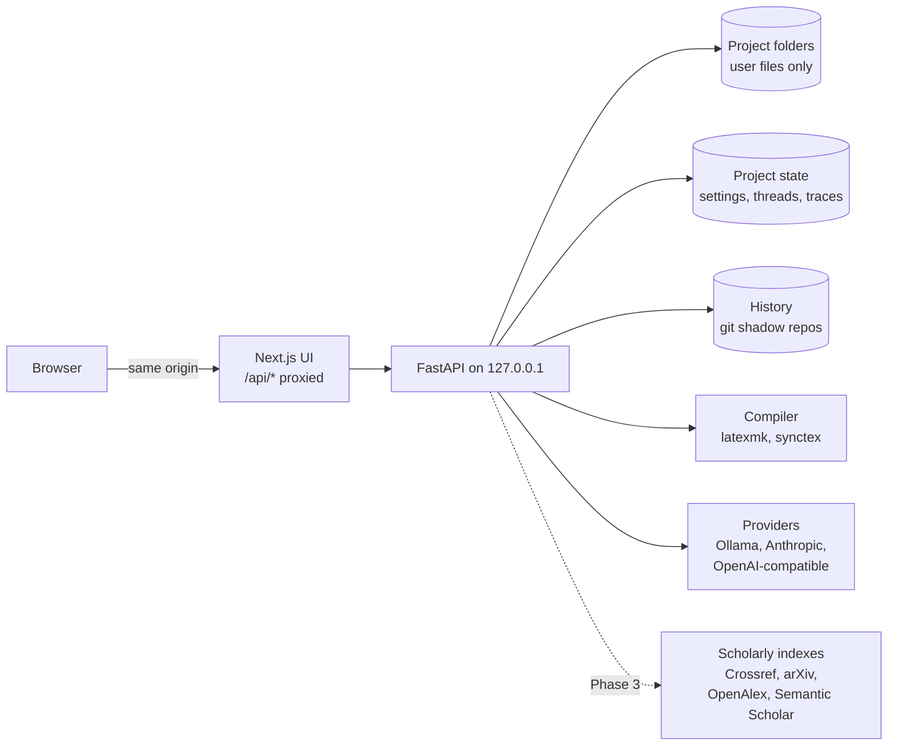

# OpenPrism revamp: design

- **Date:** 2026-11-24
- **Status:** Proposed
- **Audience:** maintainers and contributors
- **Evidence:** audits, live tests and research done on 2026-11-24, summarized in §2.
- **Companion documents:**
  - `CONTEXT.md`: glossary; this document uses its terms.
  - `docs/design/2026-11-24-agent-design.md`: the agent turn engine.
  - `docs/adr/`: decisions worth remembering.
  - `ROADMAP.md` and the GitHub milestones: the public plan.

---

## 1. Why

The in-app agent was unreliable, and the project was not yet something others could run safely, use or contribute to. This revamp rethinks what the project is for, and rebuilds the parts that matter: the agent, the editor, safety, and the project's public face. It covers the README, license, releases and planning.

Success looks like this:

1. **Fast first result.** A researcher can go from `git clone` (or one `docker run`) to a compiled paper in under ten minutes.
2. **Reviewable agent edits.** They can ask the agent for an edit, see a diff that compiles, and accept or reject it hunk by hunk.
3. **Works on free hardware.** Everyday edits work on a free local model (qwen3 4B on an 8 GB GPU). They work better on Claude or any OpenAI-compatible endpoint.
4. **No hidden changes.** The agent never silently changes, reverts or loses the user's text.
5. **A maintained-looking repository:** a clear pitch, a license, green CI, tagged releases with notes, a public roadmap, contribution guidelines and a security policy.

---

## 2. What we found

### 2.1 The agent

- **It cannot answer with the shipped configuration.**
  - The default Groq model `llama-3.3-70b-versatile` was shut down on 2026-08-16.
  - The Anthropic path sends `temperature: 0`, which every current Claude model rejects, and falls back to a retired model.
  - `CLAUDE_API_KEY` in `.env` is never read.
- **When a model does run, the host verify gate vetoes legitimate work.** It rolls back:
  - removing or renaming a section;
  - changing `\documentclass` options;
  - editing a document that was already broken;
  - any edit in a project whose root file isn't `main.tex`.

  Live run, qwen3 4B: "Remove the Skills section" was done correctly in 5 s. The gate then rolled it back while the chat said "removed".
- **Edits that do land are unsafe.**
  - LaTeX backslashes inside JSON tool arguments turn into control characters (`\textbf` becomes TAB + `extbf`), and the result still passes verification.
  - Two edits to the same file lose one of them.
  - Rollback overwrites the user's concurrent saves.
  - The UI throws away the unsaved editor buffer after every turn.
- **It is blind on local models.**
  - Ollama serves a 4,096-token context on an 8 GB GPU and silently drops the oldest messages, including the user's request, once a file has been read.
  - Live run: a one-line résumé edit took 13 minutes, made 9 failed edit attempts, changed nothing, and reported success.
- **It is missing basics:** no memory between turns, no outline or diagnostics in its context, no token streaming, no cancel, and no step or cost budget.
- **The tests cannot catch any of this.** The scripted test model ignores its inputs, and 9 of 17 mutants survive the 71 passing tests.

### 2.2 The platform

- **Security.**
  - Any website can call the local API: CORS is `*` with credentials, and there is no authentication.
  - There are four verified routes to arbitrary code execution: `/tools/run` with `latexmk -e` or `-shell-escape`, an imported `latexmkrc`, and argument injection through `main_file`.
  - TeX can read files outside the project.
  - The locked `next@15.2.4` has critical remote-code-execution advisories.
- **Compile.**
  - It is a single pdflatex pass, so citations and references print as `??`.
  - There is no `-file-line-error` and no SyncTeX.
  - Build artifacts land in the project folder.
  - Timeouts are not enforced on Windows.
  - On Windows, every write turns `\n` into `\r\n`.
- **Frontend.**
  - The editor is a `<textarea>`, although the docs claim Monaco.
  - The PDF is shown as 72-dpi PNGs, at most 10 pages.
  - The chat box is 144 px tall and covers the editor.
  - The IDE is one 818-line component.

### 2.3 The repository

- There is no license, no CI, no releases and no contributor documentation, and GitHub's community profile scores 28%.
- Personal tooling files are tracked.
- The README and project description need rewriting for the new positioning, and the skills subsystem is removed (D11).
- The docs drifted from the code; for example, they describe a Monaco editor that doesn't exist.

### 2.4 The market

- **OpenAI Prism shuts down on 2027-01-01** and deletes user data. Its users are looking for alternatives now.
- **The name is taken.** Several projects in the same category already use the name "OpenPrism" or something close to it, so it can't distinguish this project (see Q1).
- **The field is crowded.** At least five open-source AI LaTeX editors have between 400 and 1,900 stars. Breadth is not winnable.
- **The unmet need is trust.** Fabricated citations in published papers rose roughly tenfold between 2023 and 2026, and researchers' concern about privacy and hallucination keeps rising.

### 2.5 Worth keeping

- The path sandbox, zip-slip protection and the allowlisted no-shell runner.
- The outline parser, and SSE as the chat stream's transport (the v1 event union renames the tool events and drops `file_changed`).
- The idea of a host-side safety net.
- The test scaffolding and the modular example project.
- The calm dark visual baseline and the three-pane layout.

---

## 3. What it becomes

### 3.1 Positioning

OpenPrism is aimed at researchers who want AI help with unpublished LaTeX work without handing that work to a vendor's cloud. It is a self-hosted LaTeX workspace whose AI shows its work:

- every change is a diff the user reviews;
- every diff is compile-checked against the paper's existing state;
- every citation the agent touches is checked against real scholarly indexes (Phase 3, once the user allows the lookups, because they leave the machine);
- it runs on the model the user chooses, local ones included.

Verification is deterministic software rather than model quality. That makes small local models safe enough to use, so the "your own model" story and the trust story support each other.

**Draft one-line pitch:** *A self-hosted LaTeX editor with an AI agent that shows its work: every edit is a reviewable diff that compiles, every citation is checked, and it runs on the model you choose.*

### 3.2 Who it is for

- **Primary:** individual researchers and students writing papers and theses in LaTeX who care about privacy or cost, or who want an agent that understands LaTeX projects rather than a generic chat box.
- **Secondary, later:** a lab running one shared server. Multi-user accounts are out of scope for this revamp.

### 3.3 Goals

| # | Goal | Measured by |
|---|------|-------------|
| G1 | The agent makes correct, minimal, compile-safe edits | Eval pass rates per model, published in `docs/evals.md` |
| G2 | Works with Ollama, Anthropic and any OpenAI-compatible endpoint, and adapts to small models | Eval suite runs on qwen3 4B and on Claude |
| G3 | Trust: review-first proposals, differential compile checks, history with restore, never clobbers the user's text | Proposal and history tests; end-to-end tests for buffer safety |
| G4 | LaTeX table stakes: a real editor, pdf.js preview with two-way SyncTeX, multi-pass compile with bibliography, clickable diagnostics, history | End-to-end tests; feature checklist in the README |
| G5 | Citation checks and an AI provenance record | Phase 3 tests; citation audit on fixture bibliographies |
| G6 | Safe to run locally and to self-host | Security regression tests; documented threat model |
| G7 | Presentable open-source project | README, license, CI badge, releases, roadmap, community health 100% |

### 3.4 Non-goals for this revamp

Real-time collaboration and user accounts; a hosted service; a desktop app; Typst; a large template gallery; mobile layouts beyond a usable tabbed view.

### 3.5 Anti-goals

These would make the revamp a failure even if everything else works:

- AI-written text reaches the paper without the user seeing it.
- The agent adds a reference that does not exist and nothing flags it.
- A paid API is needed to get any value.
- The project looks like, or claims to be, a copy of another product.

---

## 4. Decisions

### 4.1 Calls made in this design (the maintainer can overrule any of them)

| # | Decision | Call | Why |
|---|----------|------|-----|
| D1 | Agent framework | Our own small agent loop over a provider port; remove LangChain and LangGraph (ADR 0001) | No new dependencies, because the `anthropic`, `openai` and `httpx` SDKs are already installed. We get full control over streaming, Ollama's context size, Claude prompt caching and thinking blocks, and offline tests with a fake provider. The prebuilt LangGraph agent we use was deprecated within a year. |
| D2 | How the agent works per model | Two profiles behind one turn interface (ADR 0002). **Agentic** (frontier models): the model drives tools with `str_replace`-style edits on numbered views. **Guided** (small local models): the host picks the region, and the model rewrites it as plain text in a delimited block, so LaTeX never travels inside JSON. In both profiles, LaTeX plumbing is done by the host: `ensure_package`, insert after a heading or anchor, bibliography entries and `\cite` wiring, and stripping stray `\begin{document}`/`\end{document}` from fragments. Questions get a read-only toolset. | Live runs: qwen3 4B fails multi-step JSON tool chains but passes surgical edits once its context is sized correctly and edits are tolerant. Placing content and wiring packages or bibliographies is where it still fails, so the host does it. LaTeX-in-JSON corruption is a documented, cross-tool problem. |
| D2b | Truthful outcomes | The host writes the turn's outcome line from the actual proposal and verification ("Proposed 2 changes in `main.tex`; compiles, no new errors"), never from the model's claims. "No change" is reported separately from "verified". | The model said "successfully removed" while nothing changed or was rolled back. |
| D3 | How changes reach the paper | Review-first **proposals** (ADR 0003): a turn's changes are staged, compiled in a scratch copy, and shown as hunks to accept or reject. An optional per-project setting auto-accepts proposals that compile with no new errors (off by default). | This is the trust positioning. Users praised Prism for "requires you review every change". It also removes every buffer-clobbering race, because the project folder doesn't change during a turn. |
| D4 | Verification | **Differential**: compare diagnostics against the pre-turn baseline and flag only new errors, with up to two repair rounds. Structural changes are shown in the review, never auto-rejected. | The current absolute gate rolls back legitimate work. |
| D5 | Where app data lives | The project folder holds only the user's files. Project state (settings, threads, traces, compile output, history) lives under the data directory, outside it (ADR 0004). | Plain folders with no lock-in; the agent can't write app state; exports are clean. |
| D6 | History | A git shadow repository per project, driven by the `git` CLI. There is a checkpoint on every save batch and every accepted proposal, with diff and restore. | Survives crashes, adds no new dependencies, and gives real version history (the current Versions tab is a stub). |
| D7 | Compile | latexmk by default with `-file-line-error -synctex=1` and output outside the project. The argv and environment are built only by the server and hardened. The root file and engine are set per project. | Fixes `??` citations, gives structured diagnostics and SyncTeX, and closes the code-execution routes. |
| D8 | Editor and PDF | CodeMirror 6 with the MIT `stex` mode; `@codemirror/merge` for reviewing proposals; a pdf.js viewer; SyncTeX through backend endpoints that wrap the `synctex` CLI | Overleaf moved to CodeMirror 6, and it is mobile-capable and accessible. Monaco has no LaTeX mode and no mobile support. SyncTeX was verified on MiKTeX 25.12. |
| D9 | Default local model | `qwen3:4b-instruct-2507-q4_K_M` with a 16,384-token context, not `llama3.1:8b` | Live runs: qwen3 4B passes most guided tasks; llama3.1 8B fails most even with the fixes, and Meta says the 8B can't hold a conversation with tools. |
| D10 | Default provider | None hard-coded. First-run setup detects a local Ollama and offers Anthropic or any OpenAI-compatible endpoint (presets for OpenAI and OpenRouter; any other service by base URL). | A dead hosted default is how the agent broke. |
| D11 | Removed features | The skills subsystem (not used by the agent, with content unrelated to LaTeX writing), PNG page previews (replaced by pdf.js) and `POST /tools/run` (code execution by design) | Security, focus and dead code |
| D12 | Backend package | Move `backend/app` to `backend/src/openprism` (or the new slug) with a console script `openprism serve` | A package named `app` can't be published or installed cleanly |
| D13 | Network exposure | The UI calls the API same-origin through Next.js rewrites. The backend binds 127.0.0.1 and checks Host and Origin. An optional access token covers LAN and Docker use. | Closes cross-site access and DNS rebinding without adding auth for the local case |
| D14 | Releases | SemVer 0.x and Conventional Commits; `git-cliff` run locally; signed annotated tags; `gh release create` by a maintainer; images built by CI on tag push (from v0.4.0) | Simple, verifiable releases with no release-PR churn |
| D15 | Docs | A `docs/` folder in the repository; no docs site until it is needed | Smallest tooling |
| D16 | CI | GitHub Actions with these lanes: backend on Ubuntu and Windows; a TeX Live container lane; frontend lint, type-check, test and build; a Playwright smoke run with the fake provider; one aggregate `ci-ok` required check | Matches the test strategy in §7 |
| D17 | Dependency updates | Dependabot alerts and weekly update PRs are signals only. A maintainer applies each upgrade in a normal PR, and the bot's PR is closed, not merged. | Upgrades get batched and tested together |

### 4.2 Open decisions for the maintainer (with recommendations)

| # | Question | Options | Recommendation |
|---|----------|---------|----------------|
| Q1 | Name | Rename before launch, or keep "OpenPrism" with a non-affiliation note | **Rename.** Candidates with no LaTeX projects on GitHub (checked 2026-11-24): **Stet** (proofreader's mark for "let it stand", a fit for review-first; free on npm), **Colophon**, **Refract** (a nod to the current name). All three are taken on PyPI, which matters little for a Docker-first app. Trademark clearance is still needed. |
| Q2 | License | Apache-2.0, AGPL-3.0 or MIT | **Apache-2.0** (permissive, explicit patent grant, routine for universities). Pick AGPL-3.0 only if stopping closed hosted forks matters more than adoption. |
| Q5 | Claude acceptance run | Model and cap | **Haiku 5.5** on the full eval suite (about $0.10–0.35) plus **Sonnet 5.5** on the hard subset (about $1–2), with a hard stop at $9.50 of the $10 cap. Opus 5.5 is optional, for 1 trial on the hard subset. |
| Q6 | Prism export import | Ship "Import an OpenAI Prism export" before 2027-01-01, or skip | **Ship it** in Phase 1. It is small (root detection, top-folder strip, skip `conversations/`). Mention Prism only nominatively, with a non-affiliation line. |
| Q7 | Save and compile defaults | Autosave on or off; compile on save on or off | Autosave on (debounced); compile on save off; Ctrl/Cmd+Enter compiles |
| Q8 | Example project | Keep the résumé or replace it with a research-paper template | **Paper template** (sections, a figure, `.bib`, math, cross-references); keep the résumé as a second example |
| Q9 | `AGENTS.md` | Keep a lean contributor-facing `AGENTS.md`, or none | **Keep a lean one.** It is the standard file coding tools read. |
| Q10 | AI-assisted contributions | State a policy in CONTRIBUTING or stay silent | A neutral policy: contributors are responsible for what they submit, whatever tools they use |


---

## 5. Approaches considered

### 5.1 Agent architecture

| Approach | What it means | For | Against |
|----------|---------------|-----|---------|
| A. Patch the current agent | Keep `create_react_agent`; fix memory, the gate and prompts | Least code | The API is deprecated. It keeps LangChain's provider quirks (temperature, `max_tokens` 4096 fallback for 5.5 models), offers no control over Ollama's context size, and a small model still faces a JSON tool loop. |
| **B. Own loop + provider port + two profiles (chosen)** | About 4,000 lines we own: providers, context, turn engine, tools, proposals, verification, budgets, recovery | No new dependencies, full control, a deterministic fake provider, small-model support by design | More code to own and test |
| C. LangChain v1 `create_agent` + middleware | The ecosystem's maintained agent, with built-in limits and summarization | Rich middleware | Adds `langchain` and needs a `langgraph` bump. Client-side summarization conflicts with Claude's preserved thinking. The API churns fast. |
| D. PydanticAI | A typed agent framework with excellent test models | Best testing story; built-in cost limits | Major upgrades of both the `openai` and `anthropic` SDKs; Ollama is only via `/v1`, so the context size still can't be set |

### 5.2 How agent changes reach the paper

| Approach | For | Against |
|----------|-----|---------|
| A. Write to disk, verify, roll back on failure (today) | Simple | Vetoes legitimate work; races with the user's edits; nothing to review |
| B. Write to disk with a checkpoint, then show a diff and offer undo | The agent works on real files | Unreviewed AI text sits in the paper; the user's open buffer conflicts with disk writes |
| **C. Stage as a proposal, compile in a scratch copy, the user accepts per hunk (chosen)** | Nothing lands unseen; no races; the compile check happens before review | The tools need an overlay view of the project; accepting needs base-version checks |

### 5.3 History

In-memory snapshot (today: lost on disconnect); file-copy snapshots (simple, but no diffs and heavy); **git shadow repository (chosen)**.

### 5.4 Editor

Patch the textarea (dead end); Monaco (no LaTeX mode, no mobile, heavy); **CodeMirror 6 (chosen)**.

---

## 6. Architecture

### 6.1 Overview



### 6.2 Backend modules

Each module is deep: a small interface hiding most of the behaviour, and tested through that interface. Paths assume the slug `openprism`. Signatures are abbreviated.

| Module | Interface (summary) | Hides |
|--------|---------------------|-------|
| `openprism.workspace` | `ProjectStore(DataLayout)`: `create`, `list`, `get`, `update`, `delete`, `import_zip`; `read(project_id, path) -> FileVersion`, `write(project_id, path, text, base_version)`, `write_new(project_id, path, text)`; the file tree and the outline | Path sandbox (including Windows aliases, reserved names and ADS), line-ending preservation, content-hash versions, ZIP limits and root detection, keeping project state out of reach |
| `openprism.compile` | `Compiler.compile(project_id, *, root_file, engine) -> CompileResult` (one compile per project at a time) and `Compiler.compile_dir(src_dir, ...)` for scratch trees; `CompileResult.status` (`ok`, `failed`, `timeout`, `unavailable`) with structured `Diagnostic`s; SyncTeX `forward` and `inverse` (Phase 2) | Hardened argv and env (`-no-shell-escape`, `-norc`, paranoid file access, root-file validation), timeouts with process-tree kill, output caps, UTF-8 decoding, log unwrapping and parsing, baseline cache by content hash |
| `openprism.agent` | Turn engine: start a turn, stream its events, cancel it; accept or reject proposals (§6.4) | Providers, profiles, context budgeting, tools, staging overlay, differential verification, repair rounds, budgets, threads, traces |
| `openprism.history` | `checkpoint(project_id, *, reason, message, trailers) -> Checkpoint`, `list`, `diff`, `restore` | git shadow repository mechanics, excludes, locking |
| `openprism.citations` (Phase 3) | `check_entry(entry, sources) -> CitationCheck`; `audit_project(project_id, store, sources) -> CitationAudit` | BibTeX parsing; Crossref, arXiv, OpenAlex and Semantic Scholar clients; fuzzy matching; caching; rate limits |
| `openprism.api` | FastAPI routers | Dependency injection, one error envelope (`{"detail": {"code", "message", ...}}`), versioned event stream |

### 6.3 Data layout

```
<data_dir>/                       # default ./data in development, /data in Docker, OPENPRISM_DATA_DIR overrides
  VERSION                         # data-layout version for startup migrations (Phase 4)
  settings.json                   # non-secret preferences only (§6.7)
  projects/<project_id>/          # the user's files only (what export and import see)
  state/
    ledger.jsonl                  # paid-provider cost ledger, shared by the app and eval runs (OPENPRISM_LEDGER_PATH overrides)
  state/<project_id>/
    project.json                  # name, root file, engine, settings, created_at
    active_turn                   # marker while a turn runs; an interrupted turn is closed at startup
    logs/                         # compile logs and their metadata
    threads/<thread_id>.jsonl     # append-only thread history
    turns/<turn_id>.jsonl         # trace: every event of the turn (replay source)
    turns/<turn_id>.json          # turn manifest: status, outcome, usage
    proposals/<proposal_id>.json  # the open proposal (deleted when it closes or is superseded)
    provenance.jsonl              # index of accepted AI changes, rebuilt from History on demand (Phase 3)
  history/<project_id>.git        # git shadow repository (work tree = projects/<project_id>)
  build/<project_id>/
    out/                          # latexmk -outdir: PDF, synctex, log
    assets/                       # asset cache that scratch compiles hard-link from
    scratch/<turn_id>/<digest>/   # proposal compiles; deleted when the turn finalizes
  cache/citations/                # scholarly-index lookups (Phase 3)
  backups/                        # ZIP backups taken before a data migration (Phase 4)
  evals/                          # eval runs (development only)
```

Existing local projects that still contain `.prism/` are migrated once, at startup: their metadata moves into `state/`, and their logs are dropped.

### 6.4 Agent turn engine

The interface, event union and endpoints are specified in `docs/design/2026-11-24-agent-design.md`, which comes from a four-way design comparison. In short:

- **Turns run as background jobs**, one active turn per project. Closing the browser doesn't stop a turn; only Stop does.
- **Each turn follows the same path:**
  1. Context assembly within a token budget.
  2. The profile runs (agentic tool loop, or guided region rewrite).
  3. Edits accumulate in a staging overlay.
  4. Differential verification and repair rounds run in a scratch compile.
  5. A proposal is emitted.
  6. The thread and trace are written in a `finally` block.
- **Proposals are accepted or rejected per hunk** against the base version of each file. Accepting writes a checkpoint.
- **Small-model safeguards are part of the engine**, not the prompt:
  - token counting before every request, refusing rather than truncating;
  - section-scoped reads from the outline;
  - tolerant unique matching, with closest-match errors that quote numbered raw lines;
  - a two-strike guard against repeated identical calls;
  - recovery of tool calls written as text;
  - caps on output tokens, steps, wall time and HTTP time.

### 6.5 Frontend

Next.js 16, React 19 and Tailwind, organized by feature:

- **Projects:** list, create, import.
- **Files:** tree with roles and drag-drop upload.
- **Editor:** CodeMirror 6 with `stex`, completion for commands, labels, citation keys and paths, diagnostics in the gutter, and tabs.
- **PDF:** pdf.js viewer with find and zoom; SyncTeX both ways.
- **Compile:** compile button, stale indicator and diagnostics list.
- **Agent:** a docked panel with threads, token streaming, tool cards, proposal cards, Stop and a model picker.
- **Review:** `unifiedMergeView` with per-hunk accept and reject.
- **Layout:** resizable panes, and tabs below 1024 px.

State is split into client state (zustand: tabs, buffers, dirty flags, pending proposals) and server state (TanStack Query). The API types are generated from FastAPI's OpenAPI schema. Turn events stream through the browser's native `EventSource`, and their types are generated from the event JSON Schema.

**The buffer rule:** no code path overwrites a dirty buffer. Agent changes arrive as proposals, and saves send `If-Match` with the base version.

### 6.6 Security model

Assets: the user's unpublished papers, files elsewhere on their machine, provider API keys.

Threats and the controls against each:

1. **A malicious web page calling the local API.**
   - Same-origin UI.
   - No CORS by default.
   - A Host allowlist to block DNS rebinding.
   - An Origin check on state-changing requests.
   - An optional access token, required when bound beyond loopback.
2. **A malicious project (an imported ZIP) executing code or reading files during compile.**
   - The server builds the argv.
   - The root file is validated (an existing `.tex` inside the project, not starting with `-`).
   - `-no-shell-escape` and latexmk `-norc`, with the settings we need passed on the command line.
   - `openin_any=p` and `openout_any=p`, verified on TeX Live and MiKTeX.
   - stdin closed, a timeout with process-tree kill, and output caps.
   - ZIP limits: total size, file count, compression ratio, no symlinks.
3. **The agent writing outside the project or into project state.**
   - Tools resolve paths through the workspace sandbox.
   - Project state lives outside the project folder.
4. **Provider keys leaking.**
   - Keys are read from the environment or a `.env` file only, never stored in the data directory, never sent to a different base URL, and never logged.
5. **Citation lookups revealing what a user is citing (Phase 3).**
   - Lookups are off until the user turns them on, from a consent toggle shown on first run and kept in settings.
   - No email address or other identifier is sent unless the user configures one.

`SECURITY.md` documents the threat model, the supported deployment shapes (localhost; LAN or Docker with a token) and private vulnerability reporting.

### 6.7 Configuration

Server configuration comes from variables with the `OPENPRISM_` prefix, read from the process environment or a `.env` file, plus the standard provider key names: `ANTHROPIC_API_KEY` (with `CLAUDE_API_KEY` accepted as an alias), `OPENAI_API_KEY` and `OPENROUTER_API_KEY`. Every server variable with that prefix is a field of one settings model, and `docs/configuration.md` lists them all (test-only variables are listed separately). Provider endpoints and keys come only from the environment or `.env`.

`<data_dir>/settings.json` holds only non-secret preferences that the UI edits: the default model, the default profile, autosave and the citation-lookup toggle. A preference saved there overrides the environment's default, and a project's own settings in `project.json` (profile override, auto-accept) override both. Changing a preference needs no restart.

Providers are presets:

| Preset | Adapter | Defaults |
|--------|---------|----------|
| `ollama` | Native `/api/chat` | `qwen3:4b-instruct-2507-q4_K_M`, `num_ctx` 16384, guided profile |
| `anthropic` | `anthropic` SDK | `claude-opus-5-5`, agentic profile, explicit `max_tokens`, prompt caching, no sampling parameters |
| `openai-compatible` | `openai` SDK | Presets for OpenAI and OpenRouter; any other endpoint (vLLM, LM Studio or a hosted service) through a base URL; profile from capabilities |

Two health endpoints serve different purposes:

- `GET /api/health` is the liveness check. It needs no access token, and `start.sh` and the Docker healthcheck use it.
- `GET /api/agent/health` validates the agent configuration and lists models before the first chat. It contacts only local providers unless the user asks it to probe a hosted one. The first-run UI shows it.

---

## 7. Quality: tests, evals and the Claude budget

### 7.1 Test layers

| Layer | What | When |
|-------|------|------|
| L0 static | ruff (lint and format), pyright; ESLint; `tsc --noEmit` | Every PR |
| L1 unit | Log parser, diagnostics diff, edit engine, guided block parser, control-character guard, sandbox, outline, budget guard, event reducer (frontend) | Every PR |
| L2 API | `TestClient` over temporary data roots, including security regressions | Every PR (Ubuntu and Windows) |
| L3 compile | Real TeX in a `texlive/texlive:latest-small` job container; fails instead of skipping when TeX is missing | Every PR |
| L4a agent | Fake provider that records its inputs (asserts prompt, history and tool contracts) | Every PR |
| L4b evals, replay | Golden tasks replayed through the real engine, tools and verification | Every PR (fast), nightly (full) |
| L4c evals, Ollama | Same tasks, live local models, k=3 trials, pass@k and pass^k | Manual: a local script on a maintainer's GPU machine, never a self-hosted CI runner |
| L4d evals, Claude | One frozen acceptance run under the budget guard | Manual, at Phase 1 exit; remaining budget kept for a pre-1.0 check |
| L5 frontend | Vitest and Testing Library | Every PR |
| L6 end-to-end | Playwright against backend, frontend and TeX with the fake provider | Smoke on every PR; full suite nightly |
| L7 supply chain | `pip-audit`, `npm audit --audit-level=high` | Weekly |

### 7.2 Eval suite

- **About 20 tasks.** Each task is a fixture project, a request (optionally with a selection), and programmatic checks:
  - compiles with no new errors;
  - changes are confined to allowed regions;
  - required strings are present and forbidden strings absent;
  - no control characters;
  - protected spans (preamble, `\documentclass`) unchanged unless the task allows it;
  - question tasks change nothing.
- **Starter set** (taken from real failures):
  - backslash-heavy insert;
  - remove a section;
  - rename a section and keep its label;
  - numbered equation;
  - fix a broken document;
  - add a citation (bibtex pass, no undefined citations);
  - booktabs table;
  - proofread;
  - selection-scoped "make concise";
  - one edit in a 300-line file;
  - a request that needs more than 4k tokens of context;
  - multi-turn follow-up;
  - accents and `\%` preserved;
  - new section through `\input`;
  - should-not-edit negatives.
- **Grading.** The checks are programmatic, and they alone decide pass or fail. An LLM judge for writing-quality tasks, with a rubric that allows "Unknown", is an optional Phase 3 addition: it runs only when the maintainer approves its cost, and its scores are reported beside the checks without gating a release.
- **Results.** `docs/evals.md` publishes them per model, so claims come with evidence.

### 7.3 The Claude budget

Development testing uses local Ollama models only. A paid provider (Claude) is used only for the acceptance run at the end of Phase 1 and, if the maintainer approves, one pre-1.0 regression run from what is left. Both share a hard cap of $10, and spending is kept as low as possible.

- **The budget guard.**
  - It reserves the worst case before each call (input estimate × price + `max_tokens` × output price) and settles from `usage` afterwards.
  - Spend is written to one persisted ledger that the app and the eval runs share (`OPENPRISM_LEDGER_PATH`, default `<data_dir>/state/ledger.jsonl`), and it sums across runs. The Anthropic adapter refuses a paid call when no ledger is configured.
  - It stops at **$9.50 cumulative**.
- **Contract tests cost nothing.** The Anthropic adapter's fixtures are built from the documented response shapes.
- **External backstops:**
  - a dedicated API key in a workspace with a $10 spend limit;
  - auto-reload off;
  - the key revoked afterwards.
- **Prices.** USD per million tokens, input / output: Haiku 5.5 $0.10 / $0.50; Sonnet 5.5 $2 / $10; Opus 5.5 $4 / $20. Cache reads cost 5–10% of input.
- **Run plan.** Requests run sequentially, so the cache is reused.
  1. **$0:** fake replay plus Ollama runs.
  2. **About $0.05:** a Haiku smoke pass.
  3. **About $0.10–0.35:** the Haiku full suite, 2 trials.
  4. **About $1–2:** Sonnet 5.5 on the hard subset.
  5. **Optional:** Opus 5.5 on the hard subset, 1 trial.
  6. **The rest stays in reserve** for one pre-1.0 regression run.

---

## 8. Open-source presentation

### 8.1 Repository contents

- **README.** It follows the pattern of self-hosted projects that convert visitors:
  - hero GIF; one-line pitch; badges (CI, license, release);
  - "why" in three bullets;
  - features with a comparison table (honest, dated);
  - quickstart: a Docker one-liner and native development;
  - providers table (local first); configuration table;
  - architecture diagram; roadmap link; contributing; security; license;
  - a non-affiliation line if Prism is mentioned.
- **Community files:** `LICENSE`; `CONTRIBUTING.md` (setup, tests, Conventional Commits, the review-first rule for the agent); `CODE_OF_CONDUCT.md` (Contributor Covenant 3.0); `SECURITY.md`; `SUPPORT.md`; `CHANGELOG.md` (generated by git-cliff).
- **`.github/`:** issue forms (bug, feature) with `config.yml`, a PR template, `dependabot.yml`, and workflows (`ci.yml`, `release.yml`, `nightly.yml`).
- **Planning in public:** `ROADMAP.md`; GitHub milestones (v0.1.0 … v1.0.0) with issues for each phase; one public Roadmap project.
- **Hygiene:**
  - `.gitattributes` (LF everywhere, CRLF for `.cmd`) and `.editorconfig`;
  - no boilerplate assets, no personal paths, no tool state.

### 8.2 Commits and releases

- **Messages and merges.** Conventional Commit subjects; squash merges with the PR title as the subject.
- **Releasing.** A release is: `git cliff --bump`, then a version bump in `pyproject.toml` and `package.json`, then a `chore(release): vX.Y.Z` commit, then a signed tag, then `gh release create` with notes from git-cliff. From v0.4.0, pushing the tag triggers CI to build and push a multi-arch image to GHCR.
- **Protection.** A ruleset on `main` blocks force pushes and requires `ci-ok`, and tags `v*` are protected.

### 8.3 GitHub settings

- **Profile:** a new description and 15–20 topics; the wiki off; Discussions on (Q&A, Ideas, Show and tell); a social preview image.
- **Security:** private vulnerability reporting and Dependabot alerts on; immutable releases on.
- **Actions:** pinned by SHA, with a read-only default token.

---

## 9. Roadmap

| Phase | Name | Outcome | Release |
|-------|------|---------|---------|
| 0 | Clean slate | Safe to run, honest, licensed, renamed if Q1 so decides, CI green; the old agent retired so the new one can be built on a clean base | none |
| 1 | Agent core | New turn engine with two profiles, proposals, differential verification, threads, history, eval harness; a minimal agent panel in the current UI with diff review, Stop and streaming; Prism and Overleaf ZIP import; Claude acceptance run | **v0.1.0**, first public release |
| 2 | Real editor | New IDE shell: CodeMirror 6, pdf.js and SyncTeX, docked agent panel, merge-view review, threads UI, history UI, settings | **v0.2.0** |
| 3 | Trust layer | Citation checks and audit report; agent-added references verified or flagged; one-click "fix this error"; provenance record and AI-use statement | **v0.3.0** |
| 4 | Self-host | Docker image and compose (optional Ollama), access token, data migrations, export, docs site if needed | **v0.4.0**, then v1.0.0 after a stabilization pass and the reserved Claude regression run |

`ROADMAP.md` and the GitHub milestones track the exit criteria for each phase.

---

## 10. Risks

| Risk | Mitigation |
|------|------------|
| Small local models still produce poor edits | Guided profile, region confinement, repair rounds and review-first. Publish eval numbers instead of claims; recommend Claude for heavy rewrites. |
| latexmk `-outdir`/`-auxdir`, `-norc` and `openin_any` behave differently on MiKTeX | Spike in Phase 0 on both MiKTeX and TeX Live; record the results in `docs/compile.md` |
| Scope is large for one maintainer | Phases ship independently; each plan ends in a release; the trust layer and self-host phases can slip without blocking the core |
| A rename breaks links | Rename while the repo has 1 star and before the first release; the README, docs and issue-template links change in the same commit |
| The Claude budget overruns | Client-side guard and ledger, plus a workspace spend limit and auto-reload off |
| Next.js and React upgrades break the build | Phase 0 takes the patched 15.5.x line only; Phase 2 does the Next 16 move together with the UI rebuild |

---

## 11. Left to the builder

These are minor; the builder decides and notes the choice in the PR:

- internal helper names and the exact wording of prompts and UI copy, within the voice in `CONTRIBUTING.md`;
- CSS details within the design tokens;
- log formats;
- the exact debounce timings.
